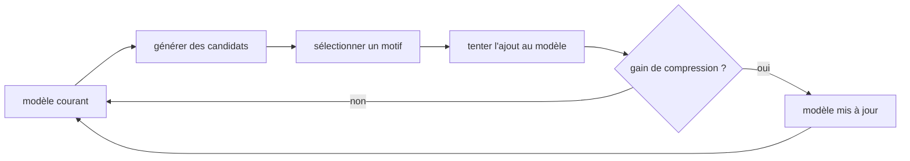

#dmv-pattern_mining_with_information_theory

# Définition

**GraphMDL+** est la version progressive de la [[Compression d'un graphe par un ensemble de motifs|compression d'un graphe par un ensemble de motifs]]. C'est un algorithme :

- **generate-and-select** : les motifs candidats sont produits au fil de la construction du modèle, puis sélectionnés, au lieu d'être extraits d'avance dans une collection fixée ;
- **any-time** : il peut être interrompu à toute itération et rend alors le meilleur modèle construit jusque-là ;
- **sans paramètre** : aucun seuil de support minimal n'est à fixer, le critère de compression jouant ce rôle.

# Interprétation

GraphMDL+ occupe vis-à-vis de GraphMDL la position que [[Algorithme SLIM|SLIM]] occupe vis-à-vis de [[Algorithme KRIMP|KRIMP]] pour les itemsets, et que [[Algorithme de recherche progressive de SQS|SQS-SEARCH]] occupe pour les séquences d'événements : la même boucle de construction, alimentée par des candidats fabriqués en cours de route.

La sélection repose sur la même mesure que pour les autres familles de motifs : la [[Taille totale d'un modèle et des données encodées|taille totale]] de description, modèle et données encodées compris.

# Remarque

Le choix de l'approche progressive ne change pas la nature du modèle, ni le critère d'évaluation : seule change la manière dont les candidats sont obtenus et le moment où la construction peut s'arrêter. Un candidat reste jugé sur le gain de compression qu'il apporte, et non sur un seuil fixé par l'utilisateur.
