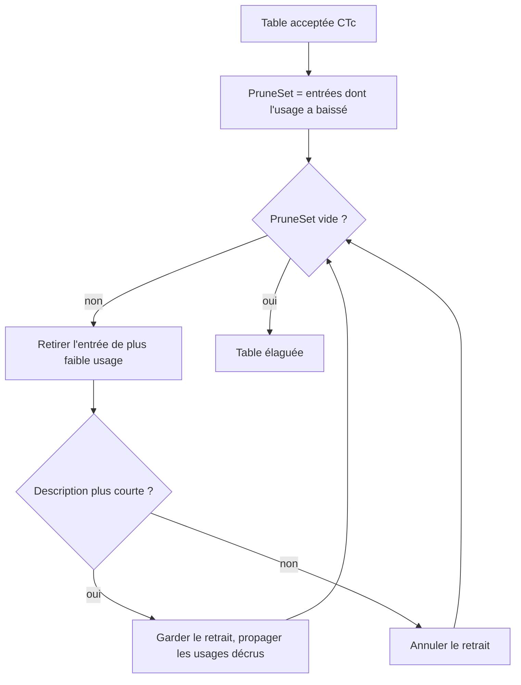

#dmv-pattern_mining_with_information_theory
# Définition

L'élagage après acceptation est la correction apportée à l'[[Algorithme KRIMP]] : à chaque fois qu'un ajout de candidat est accepté, la table acceptée est réexaminée et les entrées devenues inutiles en sont retirées.

Deux choix définissent la procédure :

- **quand élaguer** : au moment où un itemset $F$ est ajouté à la table de codes, c'est-à-dire à l'étape où l'ajout est accepté dans l'[[Algorithme KRIMP]] ;
- **quels itemsets tester** : seulement ceux dont l'usage a diminué, car leur longueur de code a augmenté.

Le second point se justifie par le lien entre usage et longueur de code : une entrée peu utilisée s'encode longuement, et une entrée dont l'usage baisse après l'ajout d'un motif plus spécifique devient un poids mort pour la description. Le détail de ce lien est donné dans [[Probabilité et longueur optimale d'un code]].

La table élaguée $CT_p$ reste un sous-ensemble de la table acceptée $CT_c$, et son élagage n'est conservé que s'il raccourcit encore la description, c'est-à-dire si $L(\mathcal{D}, CT_p) < L(\mathcal{D}, CT_c)$ au sens de la [[Taille totale d'un modèle et des données encodées]].

# Exemple

Trois tables de codes construites sur les mêmes items :

$$CT_1 = \{\{X_1,\ X_2\},\ \{X_1\},\ \{X_2\},\ \{X_3\}\}$$

$$CT_2 = \{\{X_1,\ X_2,\ X_3\},\ \{X_1,\ X_2\},\ \{X_1\},\ \{X_2\},\ \{X_3\}\}$$

$$CT_3 = \{\{X_1,\ X_2,\ X_3\},\ \{X_1\},\ \{X_2\},\ \{X_3\}\}$$

On suppose que

$$sup(\{X_1, X_2, X_3\}) = sup(\{X_1, X_2\}) - 1$$

L'ordre d'examen des candidats place $\{X_1, X_2\}$ avant $\{X_1, X_2, X_3\}$, puisque son support est plus élevé. L'algorithme passe donc par $CT_1$, accepte $\{X_1, X_2, X_3\}$ et atteint $CT_2$.

Or $CT_3$ s'obtiendrait en retirant $\{X_1, X_2\}$ de $CT_2$ : un mouvement que l'algorithme ne fait jamais, puisqu'il n'ajoute des candidats qu'un par un. $CT_3$ n'est donc jamais considéré, alors qu'il est possible que

$$L(D, CT_3) < L(D, CT_2)$$

Le problème est donc un problème d'exploration : la meilleure table peut être un voisinage par retrait d'une table atteinte par ajouts, et cette direction n'est pas visitée.

# Algorithme

La solution consiste à élaguer la table que l'algorithme vient d'accepter, plutôt qu'à changer son ordre d'examen.

```
Entrée : tables de codes CTc et CT sur une base D, avec
         {X ∈ CT} ⊂ {Y ∈ CTc} et L(D, CTc) < L(D, CT)
Sortie : table élaguée CTp, avec L(D, CTp) ≤ L(D, CTc) et CTp ⊆ CTc

1  PruneSet ← {X ∈ CT | usage_CTc(X) < usage_CT(X)}
2  tant que PruneSet ≠ ∅ faire
3      PruneCand ← l'élément X de PruneSet de plus faible usage_CTc(X)
4      PruneSet ← PruneSet \ {PruneCand}
5      CTp ← CTc \ {PruneCand}
6      si L(D, CTp) < L(D, CTc) alors
7          PruneSet ← PruneSet ∪ {X ∈ CTp | usage_CTp(X) < usage_CTc(X)}
8          CTc ← CTp
9      fin si
10 fin tant que
11 retourner CTc
```

La ligne 1 ne retient que les itemsets dont l'usage a baissé, puisque ce sont les seuls dont la longueur de code a augmenté. La ligne 3 traite en premier le plus faible usage, donc le code le plus long. Les lignes 6 à 8 ne conservent le retrait que s'il raccourcit la description, et la ligne 7 propage alors la baisse d'usage aux entrées qui dépendent des items libérés : un retrait peut en effet rendre disponibles des items que d'autres entrées vont désormais couvrir, ou au contraire priver une entrée d'une partie de ses occurrences.



# Remarque

L'élagage ne remplace pas la [[Recherche de la table de codes optimale]] : il ne fait que rattraper localement les tables qu'un parcours par ajouts successifs ne peut pas atteindre. Il ne garantit pas non plus que la table élaguée soit la meilleure, seulement qu'elle n'est pas plus longue à décrire que la table acceptée.

L'élagage a un coût : chaque acceptation déclenche une suite de tests de longueur de description, un par retrait envisagé. C'est ce coût qui rend l'heuristique praticable malgré l'absence de structure exploitable dans l'espace des tables de codes.

Comme l'élagage ne s'applique qu'aux tables déjà acceptées, il ne peut que diminuer le nombre d'entrées : les tables qu'il produit sont plus petites, et donc plus proches des propriétés attendues des [[Propriétés des tables de codes de KRIMP|tables de codes de KRIMP]].
