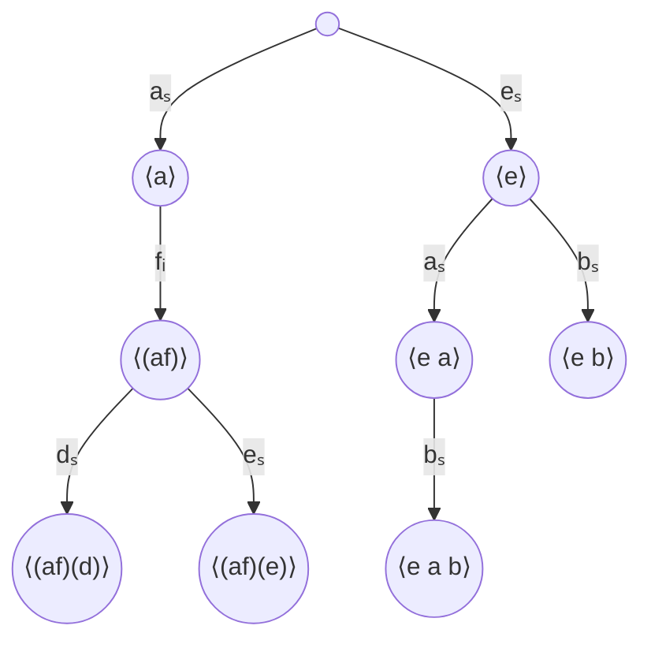

#dmv-sequence_mining

# Algorithme

CloSpan est une extension de l'[[Algorithme PrefixSpan]] pour la fouille des [[Motif séquentiel clos|motifs séquentiels clos]] : il engendre les [[Motif séquentiel|motifs séquentiels]] fréquents comme PrefixSpan, mais ne restitue que les séquences closes.

```
CloSpan(base D, seuil minsup)
  T ← tous les motifs séquentiels fréquents, rangés dans un treillis de séquences-préfixes
  pour chaque séquence s de T
      si s est incluse dans une sur-séquence de T de même support
          retirer s de T
  retourner les séquences restantes
```

L'algorithme procède en deux étapes :

- génération de tous les motifs séquentiels fréquents et stockage dans un treillis de séquences-préfixes, chaque nœud portant une séquence et son [[Support d'un motif séquentiel|support]] ;
- post-élagage, qui élimine les séquences non closes.

# Propriétés

Le post-élagage compare chaque séquence du treillis aux autres pour savoir si elle est incluse dans l'une d'elles : la comparaison deux à deux coûte $O(N^2)$, où $N$ est le nombre de séquences fréquentes stockées.

Une table de hachage réduit ce coût. Sa clé est la valeur de support : seules les séquences fréquentes de même support sont comparées entre elles, pour vérifier si l'une est incluse dans l'autre. Deux séquences de supports différents ne peuvent pas former un couple (séquence, sur-séquence de même support), donc la comparaison serait inutile.

# Exemple

Base de séquences de trois séquences :

| SID | Séquence |
| :-: | :- |
| 0 | $\langle (af)\ (d)\ (e)\ (a)\rangle$ |
| 1 | $\langle (e)\ (a)\ (b)\rangle$ |
| 2 | $\langle (e)\ (abf)\ (bde)\rangle$ |

Treillis partiel des séquences-préfixes, avec $minsup=2$ : la racine est la séquence vide et chaque arête ajoute une [[Extensions d'une séquence|extension]].



La notation des arêtes suit le type d'extension : $x_s$ ajoute l'item $x$ comme nouvel élément de la séquence, $x_i$ l'ajoute au dernier élément.

Seuls les premiers niveaux sont dessinés ; le treillis complet contiendrait toutes les séquences-préfixes dont le support atteint $minsup$.

# Remarque

Le treillis de séquences-préfixes joue le rôle du [[Treillis des itemsets|treillis des itemsets]] : la fouille engendre l'ensemble des motifs fréquents, puis un second traitement élimine ceux qui sont redondants.

L'élagage repose sur la notion de [[Motif séquentiel clos|clôture]] : une séquence non close est incluse dans une sur-séquence de même support et n'apporte donc aucune information de support supplémentaire. La sortie de CloSpan est plus compacte que celle de PrefixSpan, sans perte d'information sur le support. Les [[Motif séquentiel maximal|motifs séquentiels maximaux]] forment une réduction plus agressive encore, puisqu'aucune de leurs sur-séquences n'est fréquente : tout motif maximal est clos, mais l'inverse est faux.

Le même passage des motifs fréquents à leurs représentants clos s'opère du côté des itemsets avec les [[Itemsets fréquents fermés|itemsets fréquents fermés]].
