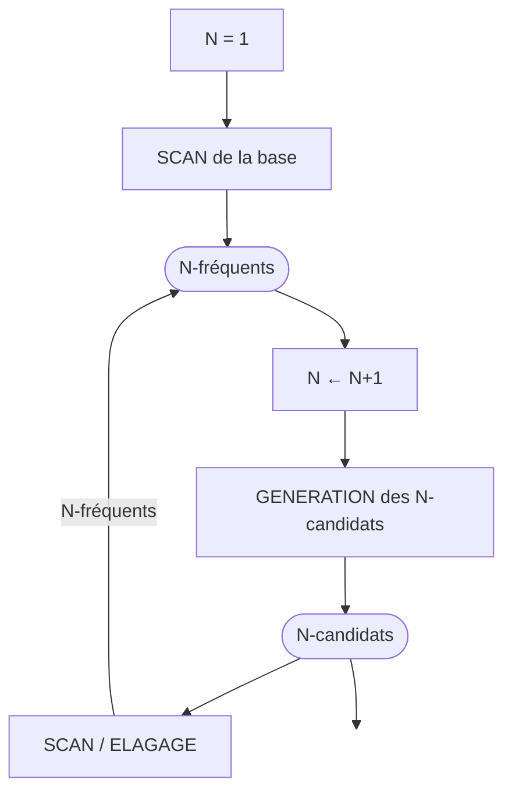

#dmv-sequence_mining

# Définition

GSP (Generalized Sequential Pattern) est un algorithme de fouille de [[Motif séquentiel|motifs séquentiels]] qui reprend la démarche de l'[[Algorithme Apriori|algorithme Apriori]] employée pour les itemsets fréquents : engendrer des candidats, puis les élaguer grâce à la propriété d'anti-monotonie du support.

Il travaille sur une [[Base de séquences|base de séquences]] au format horizontal.

# Algorithme

```
N = 0
While (Result_N != NULL)
    N = N+1
    Generate candidates (Candidates_N)
    Prune candidates (Result_N)
    Result = Result U Result_N

Result is the whole set of sequential patterns
```

La boucle construit les résultats niveau par niveau : `Result_N` contient les motifs fréquents de longueur $N$, et `Result` accumule l'ensemble complet des motifs séquentiels.



La construction se déroule ainsi :

- les candidats de longueur 1 sont les items fréquents de la base (par exemple $\langle A\rangle$, $\langle B\rangle$) ;
- les candidats de longueur 2 sont obtenus par self-join de deux motifs fréquents de longueur 1 (par exemple $\langle(A)(A)\rangle$, $\langle(A)(B)\rangle$, $\langle(A\ B)\rangle$) ;
- pour chaque niveau $k$, la base est parcourue séquence par séquence afin de compter le [[Support d'un motif séquentiel|support]] de chaque séquence candidate, puis les candidats de longueur $k+1$ sont engendrés par self-join des séquences fréquentes de longueur $k$ ;
- le processus se répète jusqu'à ce qu'aucune séquence fréquente ni aucun candidat ne puisse être trouvé.

# Remarque

Deux ingrédients sont nécessaires pour que la boucle fonctionne :

- deux types d'[[Extensions d'une séquence|extension]], pour engendrer les candidats à partir des motifs déjà validés ;
- la [[Anti-monotonie du support des motifs séquentiels|propriété d'anti-monotonie du support]], pour élaguer les candidats : un motif de longueur $k$ non fréquent rend non fréquentes toutes les $(k+1)$-séquences qui le contiennent.

La force principale de GSP est justement cet élagage par anti-monotonie, qui évite d'énumérer tout l'[[Espace de recherche des motifs séquentiels|espace de recherche]].

Le diagramme de la boucle place un premier `SCAN`, étiqueté $N=1$, hors de la boucle, puis compte $N$ sur le niveau qui entre dans la génération ; le pseudocode ci-dessus construit au contraire le niveau $N$ à l'intérieur de l'itération $N$, après l'incrément, par génération puis élagage : l'emplacement du premier balayage et le niveau auquel se rapporte $N$ diffèrent, même si les deux décrivent la même construction par niveaux.

Sur le même principe, l'[[Algorithme SPADE]] transpose la fouille au [[Format vertical des transactions|format vertical]].
