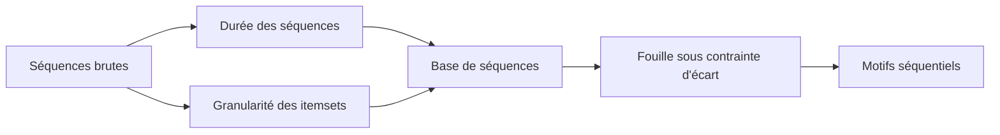

#dmv-sequence_mining

# Modèle

La fouille de [[Motif séquentiel|motifs séquentiels]] se paramètre par trois contraintes temporelles :

- la durée des séquences, qui fixe la taille des tronçons découpés dans les séquences cibles, en préparation des données : voir [[Durée des séquences]] ;
- la granularité des itemsets, qui fixe l'atomicité des transactions regroupées dans un même intervalle de temps, en préparation des données : voir [[Fenêtre de repliement des événements]] ;
- l'écart temporel entre itemsets, qui fixe le nombre d'unités de temps admis entre deux itemsets successifs d'un motif : voir [[Contrainte d'écart temporel]].

Les deux premières portent sur la construction de la [[Base de séquences]] ; la troisième porte sur la forme des motifs retenus.

# Interprétation

Les trois contraintes n'interviennent pas au même stade :

- la durée et la granularité s'appliquent avant l'extraction, pour préparer la base de séquences ;
- l'écart s'applique pendant la fouille, pour extraire les motifs séquentiels.

Une contrainte de préparation transforme les données et vaut pour toutes les extractions menées ensuite ; une contrainte de fouille filtre les candidats sur une base déjà fixée. La durée et la granularité changent donc ce que l'on peut découvrir, tandis que l'écart change seulement ce que l'on retient.

# Remarque

Les contraintes temporelles ne sont qu'une partie des contraintes possibles. D'autres portent sur autre chose que le temps :

- l'incompatibilité entre items ;
- les templates, c'est-à-dire des expressions régulières imposées à la forme du motif, au même titre que les [[Familles de motifs séquentiels|motifs exprimés en expression régulière]] ;
- la longueur des motifs.

Un motif doit alors satisfaire simultanément les contraintes temporelles et ces contraintes de forme.
