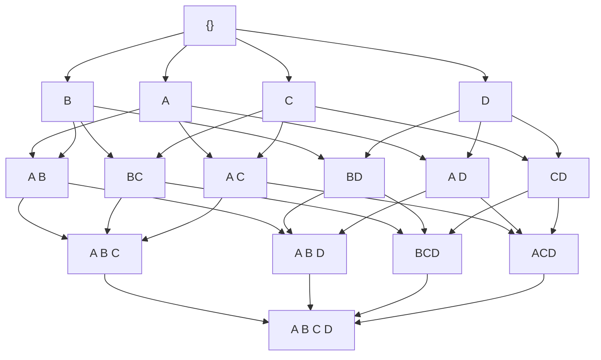
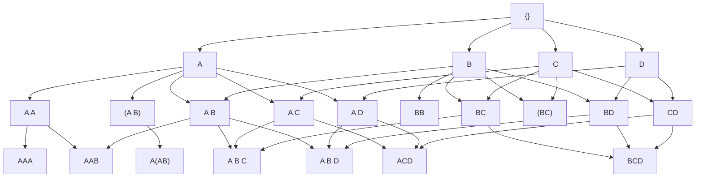

#dmv-sequence_mining

# Modèle

Une fois posé l'[[Énoncé du problème de fouille de motifs séquentiels|énoncé du problème de fouille de motifs séquentiels]], l'espace à parcourir est l'ensemble des [[Motif séquentiel|motifs séquentiels]] construits sur les items d'une [[Base de séquences|base de séquences]], rangés en niveaux de taille croissante :

- Niveau 0 : $\{\}$
- Niveau 1 : $\text{A}, \text{B}, \text{C}, \text{D}$
- Niveau 2 : $\text{A A}, (\text{A B}), \text{A B}, \text{BB}, \text{BC}, (\text{BC}), \text{A C}, \text{BD}, \text{A D}, \text{CD}, \dots$
- Niveau 3 : $\text{AAA}, \text{A(AB)}, \text{AAB}, \text{A B C}, \text{A B D}, \text{BCD}, \text{ACD}, \dots$

Un niveau $k$ rassemble les séquences formées de $k$ items au total, qu'ils soient répartis sur plusieurs éléments ou regroupés dans un même élément. Les parenthèses marquent les itemsets synchrones : dans $(\text{A B})$, les deux items appartiennent au même élément, alors que $\text{A B}$ est une suite de deux éléments successifs.

Chaque séquence se rattache aux séquences plus courtes dont elle s'obtient par [[Extensions d'une séquence|extension]], ce qui organise l'espace en graphe orienté acyclique de racine $\{\}$ : une même séquence admet plusieurs extensions immédiates, par exemple $\text{A B C}$ s'obtient aussi bien à partir de $\text{A B}$ que de $\text{A C}$ ou de $\text{BC}$.

# Exemple

Le cas non ordonné sert de point de comparaison : l'espace des itemsets sur $\{\text{A}, \text{B}, \text{C}, \text{D}\}$ forme le [[Treillis des itemsets|treillis des itemsets]], ici un treillis de Boole dont les arêtes vont d'un itemset à ses sur-ensembles immédiats.

Pour les séquences, la racine reste $\{\}$ et les quatre premiers niveaux se déploient ainsi.

# Interprétation

Le treillis des itemsets est fini : un itemset ne contient chaque item qu'une fois, donc les niveaux s'arrêtent au nombre d'items disponibles.

Dans l'espace séquentiel, un item peut au contraire se répéter dans une même séquence, comme $\text{A A}$ ou $\text{AAA}$ : les niveaux se poursuivent sans borne, et l'espace de recherche est infini. Le nombre de candidats croît donc bien plus vite que dans le cas des itemsets, ce qui rend l'énumération exhaustive impraticable et déplace l'effort vers l'élagage, comme le résume l'analyse de la [[Complexité de la fouille sur des données structurées|complexité de la fouille sur des données structurées]].

# Remarque

L'exploration de cet espace repose sur l'[[Anti-monotonie du support des motifs séquentiels|anti-monotonie du support]] : une séquence dont le [[Support d'un motif séquentiel|support]] est trop faible ne peut avoir d'extension fréquente, et la branche correspondante est coupée. C'est le principe des algorithmes générer et élaguer, à commencer par l'[[Algorithme GSP]].
