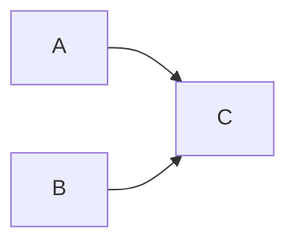

#dmv-sequence_mining

# Définition

Un épisode est une collection partiellement ordonnée d'événements qui se produisent ensemble. Il s'écrit

$$E = (V, \le)$$

où $V$ est un ensemble de types d'événements et $\le$ un ordre partiel sur ces types.

Un épisode $E$ se produit dans une [[Séquence d'événements|séquence d'événements]] $S$ s'il est possible d'apparier les types de $E$ sur des événements de $S$ de sorte que l'ordre partiel $\le$ soit respecté.

# Exemple

Selon l'ordre partiel retenu, un épisode prend trois formes.

Un ordre total donne un épisode série, noté $A \to B$ : d'autres événements peuvent s'intercaler entre $A$ et $B$ dans la séquence.

L'absence d'ordre donne un épisode parallèle : les deux types $A$ et $B$ sont présents, sans contrainte de succession.

Une forme mixte combine les deux régimes, par exemple

$$A \to C$$

$$B \to C$$

où $A$ et $B$ sont dans un ordre quelconque et précèdent tous deux $C$.

# Remarque

Ce sont surtout les épisodes série et les épisodes parallèles dont la découverte est considérée.

Un épisode généralise le [[Motif séquentiel|motif séquentiel]] : celui-ci impose un ordre total sur ses éléments, alors qu'un épisode n'exige qu'un ordre partiel.

Les notions de [[Fréquence d'un épisode|fréquence]] et d'[[Occurrence minimale d'un épisode|occurrence minimale]] servent ensuite à mesurer et à localiser les apparitions d'un épisode, dans le cadre de la [[Fouille d'épisodes dans une séquence d'événements|fouille d'épisodes]].
