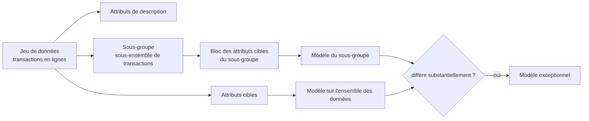

#dmv-subgroup_discovery
# Définition

La découverte de modèles exceptionnels, ou exceptional model mining, cherche des sous-groupes dont le modèle, pris sur les attributs cibles, diffère substantiellement du modèle obtenu sur le complément du sous-groupe ou sur l'ensemble des données.

# Exemple

Le jeu de données est une table dont les lignes sont des transactions et dont les colonnes se partagent en attributs de description et attributs cibles. Un sous-groupe y est un sous-ensemble de transactions : un bloc de lignes.

Trois blocs de cette table sont à distinguer :

- les lignes du sous-groupe, sur toute la largeur de la table ;
- le bloc des attributs cibles pour l'ensemble des transactions, qui fournit le modèle de référence ;
- le bloc des attributs cibles limité aux lignes du sous-groupe, qui porte le modèle du sous-groupe.

Le modèle exceptionnel est celui de ce dernier bloc : il est jugé sur son écart au modèle de référence, et non sur une simple différence de valeur moyenne d'un attribut cible.

# Remarque

La référence de la comparaison est au choix le complément du sous-groupe ou l'ensemble des données : le caractère exceptionnel s'entend toujours relativement à l'un des deux.

Le modèle comparé ne porte pas sur un attribut cible isolé comme dans la [[Tâche de découverte de sous-groupes]] usuelle, mais sur l'ensemble des [[Attributs de description et attributs cibles|attributs cibles]].

Le choix de ce que l'on appelle un modèle, et la façon de mesurer l'écart qui rend un modèle exceptionnel, sont précisés dans [[Classe de modèle et modèle exceptionnel]].
