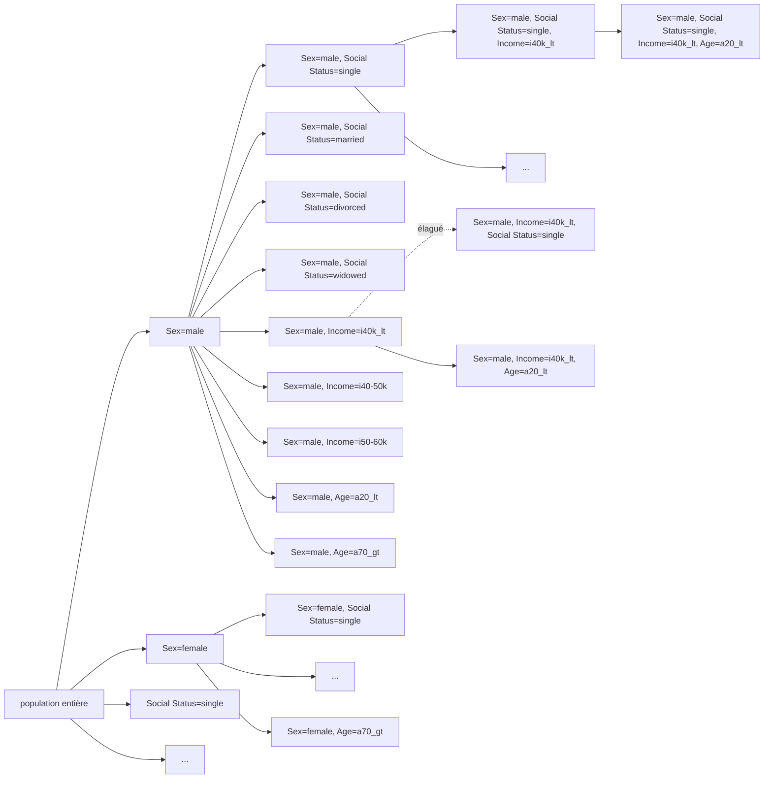

#dmv-subgroup_discovery

# Définition

L'**espace de recherche des sous-groupes** est l'arbre de toutes les conjonctions de sélecteurs obtenues par raffinements successifs à partir de la population entière.

- La racine de l'arbre est la population entière, décrite par la conjonction vide.
- Chaque nœud porte la conjonction de [[Sélecteur d'un motif de sous-groupe|sélecteurs]] qui forme la description d'un [[Motif de sous-groupe|motif de sous-groupe]] ; le motif entier ajoute à cette conjonction la propriété visée sur le concept cible.
- Les fils d'un nœud s'obtiennent en lui ajoutant un sélecteur portant sur un attribut non encore contraint : une arête descendante relie un motif à chacun de ses raffinements immédiats.
- La profondeur d'un nœud est le nombre de sélecteurs de sa conjonction.
- Sur la figure, une branche est marquée comme élaguée lorsque le raffinement qu'elle engendre reconstruirait un motif déjà produit ailleurs dans l'arbre : ce doublon n'est pas développé une seconde fois.

# Interprétation

L'arbre se lit par niveaux, la profondeur comptant les sélecteurs : le premier niveau fixe un seul attribut, puis chaque nœud se raffine en fixant la valeur d'un attribut non encore contraint, statut social, revenu ou âge pour un sous-groupe déjà décrit par le sexe. Cette lecture par niveaux décrit la structure de l'arbre, non l'ordre de visite : le parcours est une recherche exhaustive en profondeur d'abord, dont les modalités sont décrites dans [[Recherche des sous-groupes]].

Le raffinement obéit à une seule règle : il ajoute au nœud courant un sélecteur sur un attribut encore libre et engendre un fils par valeur de cet attribut. Les quatre valeurs du statut social partitionnent ainsi le sous-groupe des hommes en sous-groupes disjoints, et les tranches de revenu ou d'âge le croisent avec une condition supplémentaire.

La profondeur croît avec le nombre de sélecteurs et le sous-groupe décrit rétrécit à chaque pas, un raffinement ne retenant qu'une partie des individus du nœud père.

L'ordre dans lequel les sélecteurs sont ajoutés n'a pas d'importance, si bien qu'un même motif est atteint par plusieurs chemins : le motif qui conjoint le sexe masculin, le statut social célibataire et le revenu inférieur à 40k est produit soit en fixant le statut social puis le revenu, soit le revenu puis le statut social. La seconde arrivée sur un motif déjà engendré est élaguée, faute de quoi le même sous-arbre serait parcouru deux fois.

# Exemple

Arbre des candidats, la racine étant la population entière :

Le sous-groupe des hommes se raffine sur la figure en quatre sous-groupes par le statut social, en trois par le revenu et en deux par l'âge ; l'arbre est tronqué, comme le signalent ses nœuds « ... », de sorte que ces nombres sont ceux des raffinements dessinés, non le total des raffinements possibles.

Le motif qui conjoint le sexe masculin, le statut social célibataire et le revenu inférieur à 40k apparaît deux fois : une première fois comme fils du nœud « Sex=male, Social Status=single », une seconde fois comme fils du nœud « Sex=male, Income=i40k_lt ». Cette seconde arête, en pointillés, porte la marque d'élagage : le motif a déjà été engendré par la branche du statut social, son sous-arbre n'est pas développé une deuxième fois. Le motif atteint au niveau suivant, qui ajoute l'âge inférieur à 20 ans, n'est ainsi engendré que sur un seul chemin.

# Remarque

Cet arbre est le pendant du [[Treillis des itemsets]] pour les sous-groupes : le treillis range les itemsets par inclusion et ajoute un item à chaque montée, alors que l'arbre range les conjonctions de sélecteurs par raffinement et ajoute un sélecteur à chaque descente. Le treillis contient chaque itemset une seule fois, tandis que l'arbre atteint un même motif par plusieurs ordres d'ajout, ce qui rend l'élagage des doublons nécessaire.

L'élagage ne se réduit pas à ces doublons : dans le parcours exhaustif, une branche entière est abandonnée dès que l'[[Estimation optimiste d'une fonction de qualité|estimation optimiste]] de la qualité de son nœud passe sous la qualité du plus mauvais motif du top-k courant. L'[[Élagage top-k]] expose ce second mécanisme, que la figure ne montre pas.
