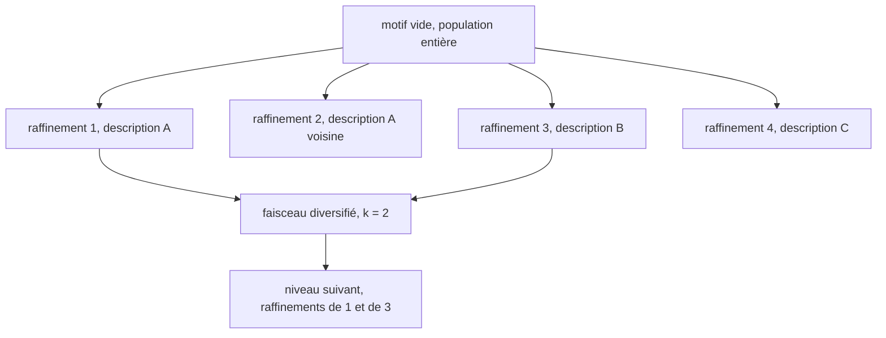

#dmv-subgroup_discovery

# Définition

La recherche en faisceau diversifiée est la [[Recherche des sous-groupes|recherche des sous-groupes]] menée en faisceau dont chaque faisceau est constitué par une [[Sélection d'un ensemble de sous-groupes|sélection d'ensemble de sous-groupes]] : le faisceau retient un top-$k$ diversifié au lieu d'un top-$k$ strict.

Elle intègre ainsi la sélection de motifs à la recherche elle-même.

# Algorithme

```
entrée : une population décrite par des attributs, un entier k (largeur du faisceau)
sortie : les sous-groupes retenus aux différents niveaux

1. partir du motif vide, qui couvre la population entière
2. répéter pour chaque niveau de l'arbre de raffinements :
   a. engendrer les raffinements des motifs du faisceau courant
   b. constituer le faisceau du niveau suivant par une sélection
      d'ensemble de sous-groupes : k sous-groupes divers de haute qualité
3. retourner les sous-groupes retenus
```

# Interprétation

La sélection ne porte plus sur le résultat final mais sur la bande de candidats qui survit à chaque niveau : le faisceau ne garde pas les $k$ meilleurs raffinements pris un à un, il garde $k$ raffinements dont les [[Motif de sous-groupe|descriptions]] et les populations couvertes diffèrent.

Deux conséquences se lisent sur le parcours.

- Un raffinement de qualité légèrement inférieure mais porteur d'une information différente est préféré à un raffinement presque identique à un candidat déjà retenu.
- Les niveaux suivants descendent depuis des motifs variés, si bien que les branches explorées ne se réduisent pas aux variantes d'une même description.



Le faisceau illustré retient les raffinements 1 et 3 : le raffinement 2, dont la description est voisine de la première, n'apporte rien de nouveau au faisceau, alors que le raffinement 3 ouvre une branche distincte.

# Remarque

La [[Sélection d'un ensemble de sous-groupes|sélection d'ensemble]] intervient ici à l'intérieur de la recherche, sur les candidats d'un niveau, et non après coup sur un ensemble de candidats déjà constitué. La [[Recherche des sous-groupes|recherche des sous-groupes]] en faisceau ordinaire est le cas particulier où le faisceau est un top-$k$ strict.

La notion de diversité que le faisceau exige de ses candidats est précisée par les [[Degrés de diversité d'un ensemble de sous-groupes]].

Le critère de qualité d'un candidat ne change pas : il reste donné par sa [[Fonction de qualité d'un sous-groupe|fonction de qualité]], et seule la règle de choix du faisceau est modifiée. Le nombre de candidats engendrés à un niveau, lui, reste celui des raffinements des motifs retenus au niveau précédent.
