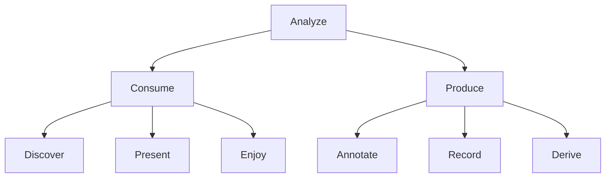

#dmv-visualization

# Définition

Une tâche d'analyse se décompose en deux familles d'actions, selon que l'utilisateur consomme ce que la vue montre ou produit quelque chose à partir d'elle.

Chaque famille se décline en trois actions élémentaires :

- Consume : Discover, Present, Enjoy
- Produce : Annotate, Record, Derive

# Interprétation

Les six actions se lisent sur ce qu'elles apportent à la vue ou à l'analyse :

- Discover : chercher une information nouvelle, que l'on ne connaît pas encore
- Present : montrer une information déjà connue, sous une forme destinée à un public
- Enjoy : contempler une visualisation pour le plaisir qu'elle procure
- Annotate : ajouter une étiquette à un élément de la vue, par exemple marquer un nœud
- Record : conserver la vue ou son état courant, par exemple une capture ou un signet
- Derive : produire de nouvelles données à partir de celles qui sont affichées, par exemple un réseau dérivé d'une table

# Remarque

Discover et Present se distinguent par ce que l'utilisateur sait déjà, non par la forme de la vue : la même figure peut servir à découvrir une information ou à la présenter. Cette classification est une sous-partie de l'[[Abstraction des tâches d'analyse]] ; elle se combine avec la [[Recherche et requête dans une visualisation|recherche]] et avec les [[Cibles d'une tâche d'analyse|cibles]] de la tâche.
