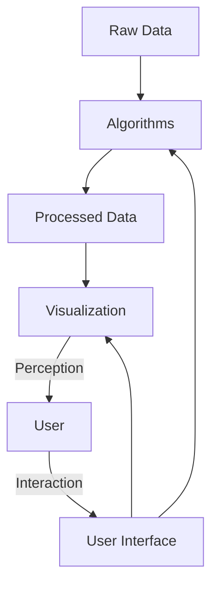

#dmv-visualization

# Modèle

Un système de visualisation s'organise en une boucle fermée entre l'utilisateur et les données : les données brutes passent par des algorithmes, produisent des données traitées, qui sont affichées ; l'utilisateur perçoit l'affichage et agit en retour sur le système par l'intermédiaire d'une interface.

Le modèle distingue quatre éléments :

- les *Raw Data*, les données d'entrée non traitées ;
- les *Algorithms*, les traitements appliqués aux données ;
- les *Processed Data*, les données issues de ces traitements ;
- la *Visualization*, la représentation affichable des données traitées.

Deux flux relient l'utilisateur au reste du système :

- la perception, de la visualisation vers l'utilisateur ;
- l'interaction, de l'utilisateur vers l'interface, qui alimente à la fois les algorithmes (nouveaux traitements) et la visualisation (nouvel affichage).

# Interprétation

L'interface se place du côté de l'utilisateur : elle est le seul canal par lequel il peut modifier les traitements ou l'affichage. Un dispositif qui n'offre que la perception, sans retour par l'interface, n'est qu'un affichage statique et non un système de visualisation.

La boucle reprend, à l'échelle d'un outil, la structure du [[Processus d'extraction de connaissances dans les bases de données]] : les données traitées y jouent le rôle des motifs, et la perception de l'utilisateur celui de l'interprétation. Le retour par l'interface est ce qui rend possible l'[[Interactivité de la visualisation]].

# Remarque

La position de l'interface dans la boucle est stable d'une application à l'autre : elle reste le point de passage obligé entre l'utilisateur, les algorithmes et la visualisation, seul l'ordre d'exposition des nœuds du schéma varie. C'est le dispositif que décrit aussi l'[[Analyse pilotée par l'utilisateur]].
