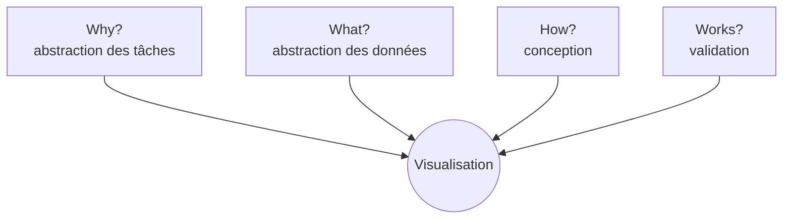

#dmv-visualization

# Modèle

Le cadre d'analyse ramène toute visualisation à quatre questions, chacune portant sur une facette du problème :

- Why? : la [[Abstraction des tâches d'analyse|tâche]] que l'utilisateur veut accomplir, exprimée sous forme abstraite ;
- What? : les données visualisées, ramenées à une [[Types de jeux de données|abstraction des données]] ;
- How? : la conception de la vue, c'est-à-dire l'arrangement des données et leur encodage ;
- Works? : la [[Validation d'une visualisation|validation]] qui établit que la visualisation fonctionne.

Les quatre facettes convergent vers la visualisation elle-même, qui occupe le centre du cadre.

# Remarque

Le cadre sert de grille de lecture : chaque question ouvre une classification propre, celle des tâches pour Why?, celle des jeux de données pour What?, celle des opérations d'arrangement et d'encodage pour How?, celle des critères d'évaluation pour Works?.

Il se superpose au [[Processus d'extraction de connaissances dans les bases de données|processus d'extraction de connaissances]] : la visualisation y occupe l'étape d'interprétation et d'évaluation des motifs extraits.

Le cycle de conception d'une visualisation parcourt ces mêmes questions dans l'ordre Why?, How?, What?, puis retour à Why? : voir [[Cycle de vie de la conception d'une visualisation]].
