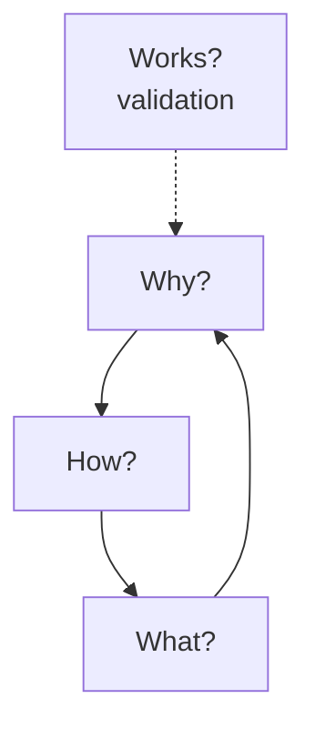

#dmv-visualization

# Modèle

La conception d'une visualisation suit un cycle de questions : Why? (la tâche), How? (la conception), What? (les données), puis retour à Why?, la validation (Works?) occupant le centre du cycle.

Le profil de l'utilisateur (expert, novice) oriente le cycle : la même tâche ne se conçoit pas de la même façon pour un utilisateur qui connaît le domaine et pour un débutant.

# Interprétation

Le cycle impose trois pratiques :

- prototyper, pour éprouver une conception avant de la figer ;
- faire confiance aux experts du domaine, qui portent la question à laquelle la visualisation doit répondre ;
- évaluer, la validation n'étant pas une étape finale mais le pivot du cycle, chaque tour de conception étant évalué avant de revenir à la question de la tâche.

# Exemple

La conception de tableaux de bord en réseau pour l'historique de patients atteints d'un cancer de la prostate après opération a produit neuf versions successives, numérotées v1 à v9 : la disposition passe d'un assemblage libre de vues à un réseau de glyphes dont le contour et les annotations se précisent de version en version, avec les barres, les boîtes à moustaches, les cercles de statut et les valeurs de PSA de plus en plus explicitement étiquetés.

Le travail porte sur quinze attributs décrivant l'état d'un patient :

| Attribut | Description | Type | Domaine de valeurs |
| :--- | :--- | :--- | :--- |
| PSA avant opération | dernier dosage de l'hormone PSA avant l'opération, indicateur biologique majeur du cancer de la prostate | numérique | $[0\,;\,200.0[$ ng/ml, médiane 8,7 |
| PSA au début du segment | valeur du PSA au début du segment temporel visualisé | numérique | $[0\,;\,4,472.0[$ ng/ml, médiane 0,21 |
| PSA en fin de segment | valeur du PSA à la fin du segment, pour apprécier la progression dans l'intervalle | numérique | $[0\,;\,4,472.0[$ ng/ml, médiane 0,26 |
| Tendance du PSA dans le segment | écart relatif entre les valeurs de PSA du segment | numérique | $]-70.3\,;\,4381.68[$ ng/ml, médiane 0,0 |
| Statut pT | statut histopathologique de la tumeur, obtenu par examen anatomopathologique, utilisé pour le pronostic | ordinal | pt2a, pt2b, pt2c, pt3a, pt3c, pt4 |
| Statut pN | caractéristiques histopathologiques de la tumeur, utilisées pour le pronostic | ordinal | NX, N0, N1 |
| Score de Gleason | caractéristiques histopathologiques de la tumeur, utilisées pour le pronostic | ordinal | 2+3, 3+2, 3+3, 3+4, 3+5, 4+3, 4+4, 4+5, 5+3, 5+4 |
| Bon état après opération | variable de résultat : bonne condition après l'opération, active jusqu'à la rechute ou aux métastases | booléen | false, true |
| Récidive biochimique | variable de résultat : récidive biochimique de la tumeur, utilisée pour le pronostic | booléen | false, true |
| Métastases | variable de résultat : apparition de métastases, indicateur biologique le plus sévère du jeu | booléen | false, true |
| Décès de la maladie | critère de jugement biologique, souvent utilisé pour les analyses de cause à effet | booléen | false, true |
| Opération | attribut de traitement : le patient a été opéré, ce qui est le cas de tous les patients du jeu | booléen | false, true |
| Radiothérapie | attribut de traitement : traitement local, limité à la zone de la prostate | booléen | false, true |
| Hormonothérapie | attribut de traitement : traitement systémique, agissant sur tout le corps | booléen | false, true |
| Chimiothérapie | attribut de traitement : appliquée dans les cas sévères, par exemple en présence de métastases | booléen | false, true |

Les quatre attributs de PSA sont numériques, les deux statuts histopathologiques et le score de Gleason sont ordinaux, et les huit variables de résultat et de traitement sont booléennes.

# Remarque

Le cycle reprend les questions du [[Cadre d'analyse de la visualisation|cadre d'analyse de la visualisation]], en bouclant de la validation vers la tâche.

Les notations d'intervalle du tableau mélangent crochets ouvrants et fermants, et la valeur 4,472.0 admet deux lectures décimales : elles sont reproduites telles quelles.
