#dmv-visualization

# Définition

Le processus d'extraction de connaissances dans les bases de données, ou KDD (*Knowledge Discovery in Databases*), est la chaîne de traitements qui transforme des données brutes en connaissance.

```mermaid
flowchart LR
    Data[(Data)] --> Selection[Selection]
    Selection --> TargetData[(Target Data)]
    TargetData --> Preprocessing[Preprocessing]
    Preprocessing --> PreprocessedData[(Preprocessed Data)]
    PreprocessedData --> Transformation[Transformation]
    Transformation --> TransformedData[(Transformed Data)]
    TransformedData --> DataMining[Data Mining]
    DataMining --> Patterns[Patterns]
    Patterns --> Interpretation[Interpretation / Evaluation]
    Interpretation --> Knowledge[Knowledge]
```

Chaque étape consomme l'artefact produit par la précédente et en produit un nouveau :

- Selection produit les *Target Data* (données ciblées).
- Preprocessing produit les *Preprocessed Data* (données nettoyées).
- Transformation produit les *Transformed Data* (données mises sous une forme exploitable).
- Data Mining produit des *Patterns* (motifs).
- Interpretation / Evaluation produit la *Knowledge* (connaissance).

Deux actions structurent ce déroulement : *Produce*, qui fabrique l'artefact intermédiaire de l'étape, et *Analyze*, qui l'examine.

Le processus est guidé par trois questions :

- What? : quelles données sont visées ?
- Why? : dans quel but les analyse-t-on ?
- How? : par quels traitements y parvient-on ?

# Interprétation

La dernière étape, l'interprétation et l'évaluation des motifs, est celle où l'humain intervient : les motifs extraits automatiquement ne deviennent de la connaissance qu'une fois examinés, confrontés au domaine et validés. C'est le point d'articulation avec la [[Visualisation assistée par ordinateur]], qui donne à l'analyste prise sur des motifs produits par la fouille.

Le processus se lit aussi comme une boucle : la connaissance produite oriente le choix des données ciblées et des transformations, ce que décrit la [[Boucle du système de visualisation]] à l'échelle d'un système interactif, et que généralise le [[Cadre d'analyse de la visualisation]] avec ses questions What?, Why?, How? et Works?.

# Remarque

Les motifs ne sont pas la connaissance : ils sont l'entrée de l'étape d'évaluation, qui peut les rejeter, les reformuler ou renvoyer à une nouvelle sélection de données.
