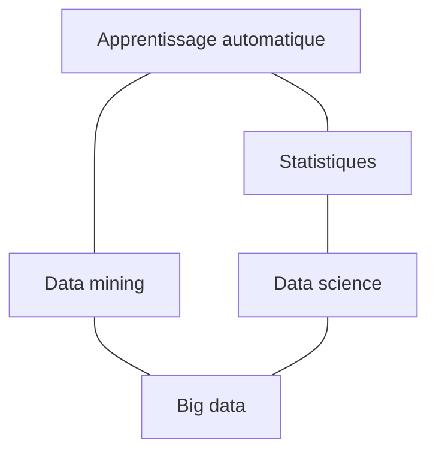

#ml-1

# Définition

Les champs liés à l'apprentissage automatique, ou [[Machine Learning|machine learning]], forment un ensemble de disciplines voisines :

- l'apprentissage automatique
- les statistiques
- le data mining
- la data science
- le big data

# Interprétation

Les liens entre ces champs se lisent sur le schéma suivant :

- l'apprentissage automatique est relié aux statistiques et au data mining
- les statistiques sont reliées à la data science
- le data mining et la data science sont tous deux reliés au big data

Le big data occupe une position de jonction : il est le seul champ relié à la fois au data mining et à la data science, sans lien direct avec l'apprentissage automatique ni avec les statistiques.

# Remarque

La [[Modélisation statistique et apprentissage automatique|modélisation statistique]] est un sous-ensemble de l'apprentissage automatique, qui l'englobe : le cadre statistique restreint l'exploration à un type particulier de fonctions et se ramène à l'estimation de densité.

Les procédures d'estimation de ce cadre relèvent de l'[[Inférence statistique]].

L'apprentissage automatique repose sur l'[[Apprentissage par l'expérience|apprentissage par l'expérience]], c'est-à-dire la capacité à généraliser à des situations inconnues à partir de cas déjà rencontrés.
