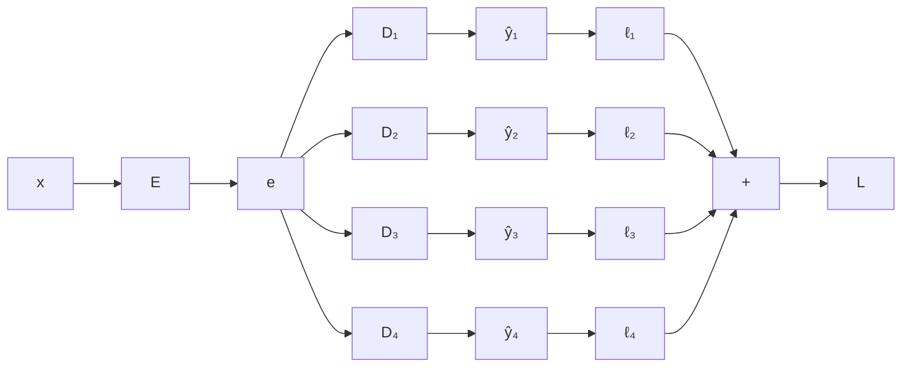

#ml-1

# Définition

L'**apprentissage multi-tâches** (*multi-task learning*) est le cadre dans lequel un même modèle répond à plusieurs tâches à partir d'une même entrée.

# Modèle

Une entrée $x$ est traitée par un encodeur $E$ partagé, qui produit une représentation $e$ commune à toutes les tâches.

Chaque tâche possède son propre décodeur, appelé **tête** et noté $D_i$ : elle produit sa prédiction $\hat{y}_i$ et sa perte $\ell_i$.

La perte totale est la somme des pertes des tâches :

$$L = \ell_1 + \ell_2 + \ell_3 + \ell_4$$

Chaque tête contient la dernière couche et la perte de sa propre tâche.

# Exemple

Une même personne est décrite par une entrée unique : taille, poids, âge, niveau d'éducation, salaire.

Plusieurs sorties sont demandées :

- est-elle mariée ?
- combien d'enfants a-t-elle ?
- est-elle endettée ?
- quelle est sa préférence politique ?

Chaque question est une tâche distincte, traitée à partir de la même entrée.

# Interprétation

L'encodeur $E$ doit servir toutes les tâches : il en résulte une représentation plus générale, qui généralise mieux.

# Remarque

Les têtes se comportent comme les décodeurs d'un [[Encodeur-décodeur]], l'encodeur étant commun à toutes les tâches.

Chaque tête portant la perte de sa tâche, l'apprentissage reste supervisé : chaque tâche dispose de ses étiquettes. Il se distingue en cela de l'[[Apprentissage semi-supervisé]], où les données non étiquetées complètent les données étiquetées d'une même tâche.
