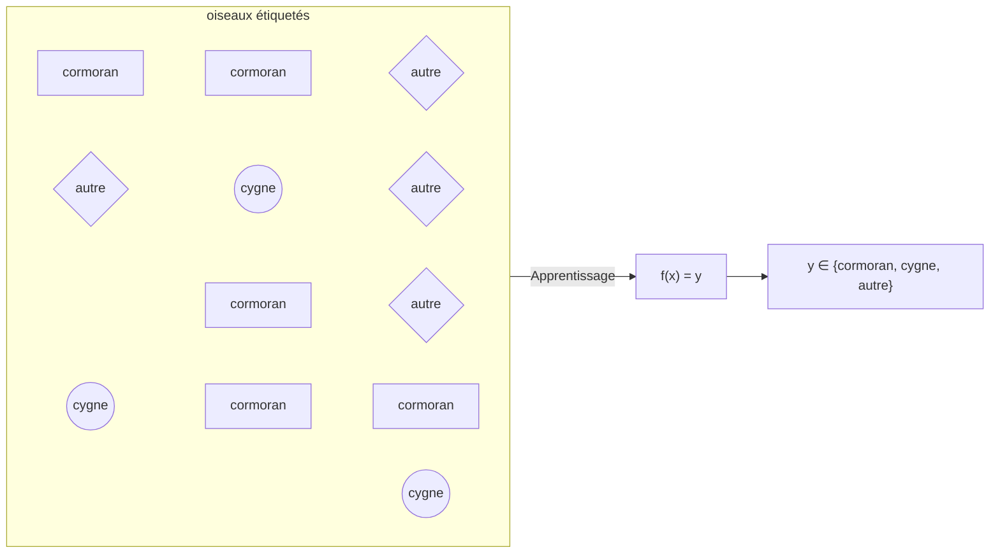

#ml-1

# Définition

L'**apprentissage supervisé** est un type de tâche d'apprentissage dans lequel l'ensemble des classes, ou des valeurs possibles de la cible, est connu à l'avance.

Les étiquettes forment la vérité terrain (*ground truth*) : chaque donnée d'apprentissage est accompagnée de la réponse attendue.

# Exemple

Avec trois classes, chaque classe est considérée séparément, à travers ses échantillons positifs et ses échantillons négatifs.

Sur un nuage d'oiseaux déjà étiquetés (cormoran, cygne, autre), l'apprentissage produit une fonction $f(x) = y$ dont la sortie $y$ appartient à l'ensemble des trois classes :

La forme du nœud marque la classe : carré pour le cormoran, cercle pour le cygne, losange pour l'autre.

# Remarque

L'apprentissage supervisé s'oppose à l'[[Apprentissage non supervisé]], où les données ne portent pas d'étiquette et où les classes sont inconnues en nombre et en nature.
