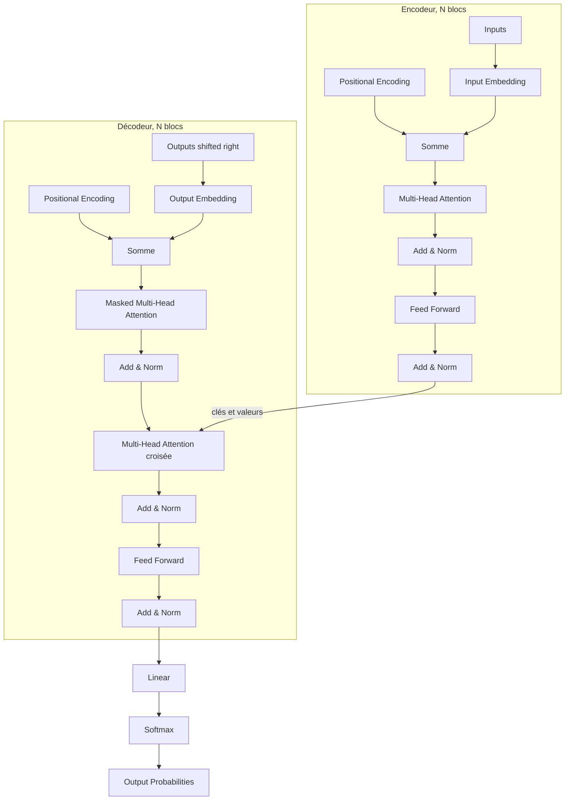

#ml-3

# Définition

Le Transformer est une architecture de réseau de neurones de type encodeur-décodeur, destinée aux tâches séquence à séquence et construite par empilement de blocs identiques répétés $N$ fois.

Le bloc de l'encodeur associe deux sous-couches, un mécanisme d'attention puis un petit réseau feed-forward ; le bloc du décodeur en comporte trois : une self-attention masquée, une attention croisée sur la sortie de l'encodeur, puis un réseau feed-forward. Chaque sous-couche est entourée d'une connexion résiduelle suivie d'une normalisation (`Add & Norm`).

L'architecture complète comporte trois attentions distinctes :

- une [[Self-attention]] dans l'encodeur, non masquée
- une self-attention masquée dans le décodeur
- une attention croisée dans le décodeur, dont les requêtes viennent du décodeur et les clés et valeurs de la sortie de l'encodeur

# Modèle

## Encodeur, répété $N$ fois

- `Inputs` : la séquence source découpée en jetons
- `Input Embedding` : chaque jeton devient un vecteur, voir [[Couche de plongement]]
- somme de ces vecteurs avec le `Positional Encoding`, voir [[Encodage positionnel]]
- `Multi-Head Attention`, puis `Add & Norm`, voir [[Attention multi-têtes]]
- `Feed Forward`, puis `Add & Norm`, voir [[Réseau feed-forward du Transformer]]

## Décodeur, répété $N$ fois

- `Outputs (shifted right)` : la séquence cible décalée d'un pas vers la droite
- `Output Embedding`, puis somme avec le `Positional Encoding`
- `Masked Multi-Head Attention`, puis `Add & Norm`, voir [[Masque causal]]
- `Multi-Head Attention` croisée avec la sortie de l'encodeur, puis `Add & Norm`
- `Feed Forward`, puis `Add & Norm`

## Tête de sortie

`Linear`, puis `Softmax`, puis `Output Probabilities` : le modèle renvoie la probabilité de chaque jeton possible du vocabulaire, ce qui en fait une tâche de classification dont la perte est l'[[Entropie croisée multi-classe|entropie croisée]].

La couche `Linear` projette la représentation de dimension $d$ sur la taille du vocabulaire, et le [[Fonction softmax|softmax]] normalise ces scores en une distribution.

## Circulation des tenseurs

Le trajet d'un lot de jetons se lit ainsi :

- les identifiants de jetons sont convertis par la table d'embedding, de taille $|\mathcal{V}| \times d$, par simple accès à une ligne par jeton ; quatre jetons donnent un tenseur $T$ de taille $4 \times d$
- l'encodage positionnel est ajouté à $T$, il ne remplace pas l'information sémantique
- les projections linéaires forment $Q$, $K$, $V$ à partir du même $T$ pour la self-attention
- pour l'attention croisée, $Q$ provient du décodeur tandis que $K$ et $V$ proviennent de la sortie du dernier bloc encodeur
- la dimension $d$ est découpée en $n_h$ têtes de dimension $d_k = d / n_h$ ; avec $d = 1024$ et $n_h = 8$, chaque tête travaille sur $128$ features, et la concaténation des têtes retrouve la dimension $d$ avant une dernière projection linéaire
- la sortie du dernier bloc décodeur passe par la tête linéaire et le softmax pour donner les probabilités du jeton suivant

Chaque jeton de sortie est ainsi produit à partir de la source encodée et des jetons déjà générés : la flèche issue des jetons source pointe vers le premier jeton prédit.

# Propriétés

- L'attention est au cœur du modèle, sans aucune couche récurrente.
- Les entrées sont traitées en parallèle : il n'est pas besoin d'avoir lu toute la séquence avant de lire le dernier élément.
- L'entraînement est plus facile sur de très grands jeux de données.
- Chaque position de la séquence source et chaque position de la séquence cible disposent de leur propre représentation, calculées en parallèle, chaque position s'appuyant sur toutes les autres via l'attention (les seules positions antérieures dans le décodeur).
- Une connexion résiduelle entoure chaque sous-couche et la normalisation `Add & Norm` suit l'addition, voir [[Connexions résiduelles]].
- Le décodeur est causal et autorégressif : il ne voit que les positions précédentes, et sa prédiction est réinjectée en entrée au pas suivant, voir [[Génération d'une séquence]].
- L'architecture est à la base des modèles modernes de traitement du langage ; selon la pile conservée (encodeur, décodeur, ou les deux), elle donne les variantes encodeur-décodeur, encodeur seul et décodeur seul, voir [[Variantes du Transformer]].

# Interprétation

L'encodeur construit une représentation de la phrase source que le décodeur interroge à chaque pas : la self-attention de l'encodeur met en relation les mots de l'entrée entre eux, l'attention croisée fait correspondre chaque position de sortie aux positions utiles de l'entrée, et l'attention masquée du décodeur organise le préfixe déjà produit.

Dans le bloc encodeur, les deux sous-couches ont des rôles complémentaires : l'attention mélange l'information entre les positions, le réseau feed-forward transforme chaque position séparément.

# Remarque

La propriété de causalité et d'autorégression ne vaut que pour le décodeur : l'encodeur, lui, lit toute la séquence source et reste bidirectionnel, ce qui est la condition pour que l'attention croisée dispose de la totalité de l'entrée.

Le masque du décodeur n'est pas un détail d'implémentation : il garantit que la prédiction d'une position ne dépend que des positions antérieures, ce qui autorise le calcul de toute la séquence en un seul passage à l'entraînement.
