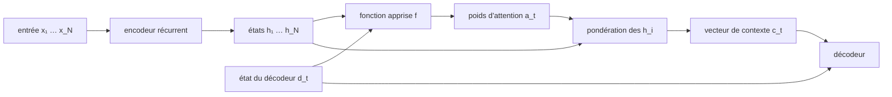

#ml-3

# Modèle

Un [[Encodeur-décodeur pour les séquences|encodeur-décodeur]] séquentiel traite une phrase mot à mot. L'encodeur, un [[Réseau récurrent]], produit la séquence des plongements de chaque entrée $x_i$, soit $\mathbf{h}=[h_1,\dots,h_N]$. À chaque pas $t$, le décodeur détient un état caché $d_t$ et doit choisir sur quoi porter son attention : le principe de l'attention est de construire, pour ce pas, une pondération des états de l'encodeur, puis de résumer ceux-ci en un vecteur unique fourni au décodeur.

Le procédé lève le goulot d'étranglement de l'[[Encodage d'une séquence|encodage d'une séquence]], où toute l'entrée est comprimée en un seul vecteur fixe : ici le résumé de l'entrée est recalculé à chaque pas, en fonction de ce que le décodeur cherche à produire.

# Définition

À l'instant $t$, le décodeur dispose de l'état caché $d_t$. La question à résoudre est la suivante : étant donné $d_t$, quelle attention $a_i\in[0,1]$ accorder à chaque $h_i$ ? Le vecteur des poids d'attention à l'instant $t$ est $\mathbf{a}_t=[a_1,\dots,a_N]$.

Le produit pondéré terme à terme de ce vecteur par la séquence des états de l'encodeur s'écrit $\mathbf{a}_t\odot\mathbf{h}=[a_1h_1,a_2h_2,\dots,a_Nh_N]$, où $\odot$ désigne le produit de Hadamard, c'est-à-dire le produit composante par composante.

Le vecteur de contexte est la somme des composantes de ce produit :

$$c_t=\sum_{i=1}^{N}a_ih_i.$$

# Algorithme

1. L'encodeur calcule les états $\mathbf{h}=[h_1,\dots,h_N]$ de l'entrée.
2. Le décodeur prédit la nouvelle sortie à partir de $\hat{y}_t$, de $d_t$ et du vecteur de contexte $c_t$, dont le calcul est détaillé dans le [[Score d'attention de Bahdanau|score d'attention de Bahdanau]].

La récurrence du décodeur s'écrit donc, en substituant $f(d_t,\mathbf{h})$ par $\mathbf{a}_t$ :

$$(\hat{y}_{t+1},d_{t+1})=D(\hat{y}_t,d_t,\mathbf{a}_t\odot\mathbf{h}).$$

Comme $\mathbf{a}_t\odot\mathbf{h}$ se somme en $c_t$, la même récurrence se lit avec le vecteur de contexte :

$$(\hat{y}_{t+1},d_{t+1})=D(\hat{y}_t,d_t,c_t).$$

# Exemple

La traduction de « How was your day » en « Comment s'est passée ta journée » sert d'illustration. La sortie française compte cinq mots, produits pas à pas, tandis que l'entrée compte quatre mots, dont les états cachés sont $h_1$ pour *How*, $h_2$ pour *was*, $h_3$ pour *your* et $h_4$ pour *day*.

| Sortie | *Comment* | *se* | *passe* | *ta* | *journée* |
|---|---|---|---|---|---|
| État du décodeur | $d_1$ | $d_2$ | $d_3$ | $d_4$ | |
| Poids d'attention | $a_1, a_2, a_3, a_4$ | $a_1, a_2, a_3, a_4$ | $a_1, a_2, a_3, a_4$ | $a_1, a_2, a_3, a_4$ | $a_1, a_2, a_3, a_4$ |

| Entrée | *How* | *was* | *your* | *day* |
|---|---|---|---|---|
| État caché | $h_1$ | $h_2$ | $h_3$ | $h_4$ |

Chaque pas du décodeur dispose ainsi d'un vecteur de quatre poids, un par état de l'encodeur. La carte d'attention se lit sur une échelle d'intensité, de l'important (sombre) au sans importance (clair) : pour chaque mot produit, une ligne donne le poids affecté à chacun des quatre mots de l'entrée. Un mot produit s'appuie fortement sur un mot d'entrée précis, et faiblement sur les autres, ce qui montre que le contexte $c_t$ n'est pas le même d'un pas à l'autre.

# Interprétation

L'attention s'interprète comme un moteur de recherche rudimentaire :

- la **requête** est $d_t$, ce que le décodeur cherche ;
- les **documents** sont $h_1,\dots,h_N$, les états de l'encodeur ;
- le **score de pertinence** $a_i$ mesure la qualité de l'appariement de $h_i$ avec $d_t$ ;
- le **résultat** est $c_t=\sum_i a_ih_i$, les documents mélangés selon leur score.

Le score est normalisé par un softmax, si bien que $\sum_i a_i=1$ : les poids forment une distribution sur les états de l'encodeur. Dans ce cadre, le score est appris par une petite couche dense plutôt que calculé comme une similarité, ce qui est le [[Score d'attention de Bahdanau|score d'attention de Bahdanau]]. L'encodeur et le décodeur sont des chaînes de [[Réseau récurrent|réseaux récurrents]], et chaque pas du décodeur reçoit le vecteur de contexte correspondant.

# Propriétés

- Les poids d'attention sont bornés : $a_i\in[0,1]$.
- Avec une activation finale softmax, ils sont normalisés : $\sum_i a_i=1$.
- La fonction $f$ qui produit les poids est apprise, et non fixée à l'avance.
- Le vecteur de contexte est un résumé de l'entrée recalculé à chaque pas, au lieu d'être figé une fois pour toute la séquence.

# Remarque

Dans la présentation du mécanisme, le produit pondéré est noté avec le symbole $\otimes$, réservé au produit tensoriel, alors que le résultat est un vecteur de produits composante par composante : la notation correcte est le produit de Hadamard $\odot$, employée ici, et la somme qui donne $c_t$ complète l'opération.

L'attention décrite ici porte sur une séquence d'entrée produite par un encodeur ; la [[Self-attention|self-attention]] en est le cas où requête, clés et valeurs proviennent d'une même séquence, généralisation exposée dans le [[Mécanisme d'attention]].

Le [[Mécanisme de copie]] réutilise ces poids d'attention comme distribution sur les mots d'entrée, ce qui permet de recopier un mot rare au lieu de le générer.
