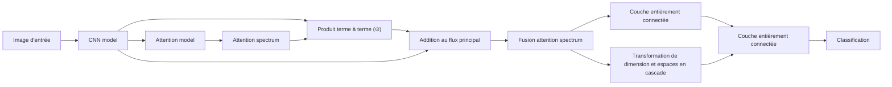

#ml-3

# Définition

Dans un réseau convolutif appliqué à une image, l'attention intervient selon deux axes :
- apprendre la matrice d'attention ;
- pondérer les pixels.

# Modèle

La chaîne complète enchaîne neuf étapes :

| Étape | Élément |
|---|---|
| 1 | Image d'entrée |
| 2 | CNN model |
| 3 | Attention model |
| 4 | Attention spectrum |
| 5 | Fusion attention spectrum |
| 6 | Dimension transformation/space cascading |
| 7 | Full connection layer |
| 8 | Full connection layer |
| 9 | Classification |

Le signal issu du **CNN model** est combiné avec l'**Attention spectrum** via un produit terme à terme $\odot$, puis additionné (⊕) au flux principal avant la **Fusion attention spectrum**.

La **Fusion attention spectrum** alimente la première couche entièrement connectée. La transformation de dimension et espaces en cascade part de la fusion et rejoint l'extrémité basse de la seconde couche entièrement connectée, que la première alimente aussi.

# Remarque

Il s'agit d'une variante visuelle du [[Mécanisme d'attention]] : le [[Réseau de neurones convolutif]] fournit les caractéristiques extraites par ses [[Couche de convolution|couches de convolution]], et le spectre d'attention les recombine avant la classification. La même articulation entre une représentation et un spectre de poids se retrouve dans l'[[Attention dans un encodeur-décodeur]], où la pondération porte sur les états d'une séquence plutôt que sur les pixels.
