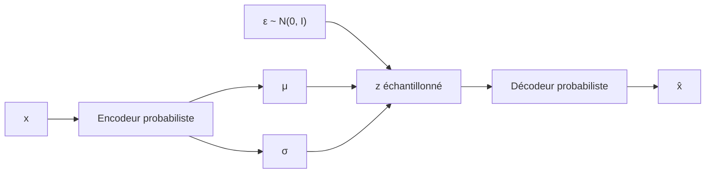

#ml-2

# Définition

L'auto-encodeur variationnel est un [[Auto-encodeur]] muni d'une hypothèse forte sur la distribution des plongements $\mathbf{z}$ : celle-ci est supposée suivre une loi normale, le plus souvent $\mathcal{N}(0, I)$.

L'encodeur ne produit plus un point de l'espace latent mais les paramètres d'une loi :

$$q(\mathbf{z} \mid \mathbf{x}) = \mathcal{N}\big(\boldsymbol{\mu}(\mathbf{x}), \boldsymbol{\sigma}^2(\mathbf{x})\big)$$

Autrement dit, à chaque entrée $\mathbf{x}$ correspond une distribution sur l'espace latent, dont l'encodeur fournit la moyenne $\boldsymbol{\mu}(\mathbf{x})$ et la variance $\boldsymbol{\sigma}^2(\mathbf{x})$.

# Modèle

Trois éléments composent le modèle.

| Élément | Rôle |
|---|---|
| Encodeur probabiliste | Produit $\boldsymbol{\mu}(\mathbf{x})$ et $\boldsymbol{\sigma}^2(\mathbf{x})$ |
| Espace latent | Distributions $\mathcal{N}(0, I)$ et échantillonnage de $\mathbf{z}$ |
| Décodeur probabiliste | Reconstruit $\hat{\mathbf{x}}$ depuis $\mathbf{z}$ |

L'échantillonneur intercale un tirage entre l'encodeur et le décodeur : $\mathbf{z}$ est tiré dans $q(\mathbf{z} \mid \mathbf{x})$, puis le [[Décodeur génératif|décodeur]] produit la reconstruction $\hat{\mathbf{x}}$.

# Algorithme

L'entraînement enchaîne quatre étapes.

1. L'encodeur transforme l'entrée : $\mathbf{x} \rightarrow \boldsymbol{\mu}(\mathbf{x}), \boldsymbol{\sigma}(\mathbf{x})$.
2. L'échantillonnage suit l'[[Astuce de reparamétrisation]] : $\mathbf{z} = \boldsymbol{\mu}(\mathbf{x}) + \boldsymbol{\sigma}(\mathbf{x}) \odot \boldsymbol{\varepsilon}$, avec $\boldsymbol{\varepsilon} \sim \mathcal{N}(0, I)$.
3. Le décodeur reconstruit : $\hat{\mathbf{x}} = d(\mathbf{z})$.
4. La perte combine reconstruction et régularisation de la loi latente, puis l'ensemble est optimisé par rétropropagation.

L'aléa est porté par $\boldsymbol{\varepsilon}$ et non par les paramètres du réseau : le gradient traverse $\boldsymbol{\mu}$ et $\boldsymbol{\sigma}$, ce qui rend l'entraînement compatible avec la rétropropagation.

# Propriétés

La perte du modèle additionne deux termes :

$$\mathcal{L} = \lVert \mathbf{x} - \hat{\mathbf{x}} \rVert^2 + \mathrm{KL}\big(q(\mathbf{z} \mid \mathbf{x}) \,\|\, \mathcal{N}(0, I)\big)$$

Le premier terme est la perte de reconstruction, ici l'erreur quadratique (voir les [[Mesures d'erreur en régression]]).

Le second terme est la divergence de Kullback-Leibler entre la loi latente conditionnelle produite par l'encodeur et la loi normale centrée réduite.

Lorsque $q(\mathbf{z} \mid \mathbf{x})$ est gaussienne à covariance diagonale, c'est-à-dire de composantes indépendantes, ce terme de divergence vaut :

$$\mathrm{KL}\big(q(\mathbf{z} \mid \mathbf{x}) \,\|\, \mathcal{N}(0, I)\big) = \tfrac{1}{2} \sum_i \big(\mu_i^2 + \sigma_i^2 - \log \sigma_i^2 - 1\big)$$

# Interprétation

Le tirage de $\mathbf{z}$ dans $q(\mathbf{z} \mid \mathbf{x})$ introduit un non-déterminisme : la même entrée ne donne pas toujours le même plongement, contrairement à l'[[Auto-encodeur]] déterministe.

La divergence KL joue le rôle de régularisation : elle rapproche la loi des plongements de $\mathcal{N}(0, I)$ et évite que l'encodeur ne concentre chaque entrée sur un point isolé.

Pour la génération, on oublie l'encodeur : on tire $\mathbf{z} \sim \mathcal{N}(0, I)$ et on renvoie $d(\mathbf{z})$. Le terme KL maintient l'espace latent « rempli », de sorte que tout $\mathbf{z}$ tiré de $\mathcal{N}(0, I)$ se décode en quelque chose de plausible.

# Remarque

La forme close $\tfrac{1}{2} \sum_i (\mu_i^2 + \sigma_i^2 - \log \sigma_i^2 - 1)$ ne décrit que le terme de divergence : elle ne remplace pas la perte complète, à laquelle s'ajoute toujours le terme de reconstruction. Écrire $\mathcal{L}$ égal à cette seule somme est une erreur fréquente.
