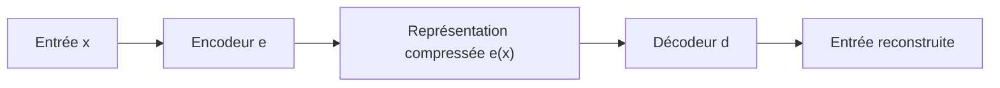

#ml-1

# Définition

Un **auto-encodeur** est un réseau de neurones entraîné à prédire sa propre entrée : la cible est l'entrée elle-même, et une perte $\ell(\hat{x}, x)$ mesure l'écart entre la reconstruction $\hat{x}$ et l'entrée $x$, le plus souvent au sens de l'erreur quadratique moyenne.

Le réseau est la composition de deux fonctions :

- un **encodeur** $e$, qui transforme l'entrée $x$ en une représentation $e(x)$ ;
- un **décodeur** $d$, qui produit la reconstruction $\hat{x} = d(e(x))$.

Ce qui distingue l'auto-encodeur est le **goulot d'étranglement** : la dimension de $e(x)$ est plus petite que celle de $x$.

Aucune étiquette n'intervient dans l'entraînement : l'auto-encodeur relève de l'[[Apprentissage non supervisé|apprentissage non supervisé]].

# Interprétation

Le goulot d'étranglement rend la copie impossible : la représentation intermédiaire est trop petite pour transmettre l'entrée telle quelle, donc le réseau doit **compresser**.

Pour compresser, il doit trouver ce que les entrées ont en commun : il **organise** ainsi son espace de représentation.

Une fois l'entraînement terminé, on ne conserve que l'**encodeur** : $e(x)$ est une représentation compacte de $x$, qui s'interprète comme un [[Plongement|plongement]] de l'entrée.

# Exemple

Trois usages de l'auto-encodeur :

- **Débruitage** : l'entrée est bruitée et la cible est propre, la perte devenant $\ell\big(d(e(x + b)), x\big)$ où $b$ désigne un bruit ajouté à l'entrée.
- **Visualisation** : $e$ projette une image vers $\mathbb{R}^2$ ; les chiffres d'une base de chiffres manuscrits se rassemblent par classe, bien qu'aucune étiquette n'ait été fournie.
- **Pré-entraînement** : $e$ est appris sur beaucoup de données non étiquetées, puis un petit classifieur est entraîné sur $e(x)$ avec peu d'étiquettes.

# Remarque

Le pré-entraînement rattache l'auto-encodeur à l'[[Apprentissage semi-supervisé]] : les données non étiquetées servent à apprendre la représentation, les données étiquetées à entraîner le classifieur final.

L'auto-encodeur est le cas non supervisé de l'[[Encodeur-décodeur]].
