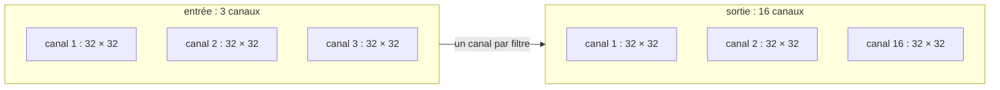

#ml-2

# Définition

Un canal est un plan d'un tenseur : la composante qui indexe des grilles de même forme, empilées dans l'épaisseur. Un lot se range en $(B, C, \dots)$ : le lot, les canaux, puis les axes spatiaux, dont le nombre est la dimension de la donnée. Pour une image en deux dimensions, la forme est $(B, C, H, W)$ : l'axe $C$ énumère les canaux, et chaque canal est une grille de $H \times W$ valeurs.

# Exemple

Une image en couleurs de $32 \times 32$ pixels a pour forme $(3, 32, 32)$ : trois canaux, un par composante de couleur. Après une [[Couche de convolution]] de $3$ canaux d'entrée vers $16$ canaux de sortie, avec un noyau $3 \times 3$ et un padding d'un pixel qui conserve la résolution, le tenseur prend la forme $(16, 32, 32)$ : seize canaux, chacun produit par un [[Filtre de convolution|filtre]] distinct.

# Propriétés

- La forme suit la dimension de la donnée : $(B, C, L)$ en une dimension, $(B, C, H, W)$ en deux dimensions, $(B, C, D, H, W)$ en trois dimensions.
- En deux dimensions, un canal est une grille $H \times W$ ; en une dimension, un vecteur de $L$ valeurs.
- La profondeur d'un tenseur est son nombre de canaux.
- Une convolution somme sur les canaux d'entrée et produit un canal par filtre : les canaux d'entrée sont traversés, les canaux de sortie sont empilés.
- Chaque canal de sortie est une [[Carte d'activation]].

# Remarque

Un canal ne porte pas de couleur en général : dans une couche cachée, il porte une carte d'activation, c'est-à-dire les réponses d'un filtre sur toute l'image. Seul le premier canal d'entrée d'une image a une lecture perceptive immédiate, et cette lecture dépend de l'encodage des couleurs, pas de la convolution.
