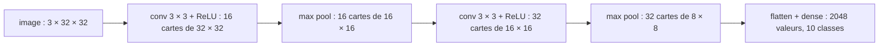

#ml-2

# Définition

Une carte d'activation est la grille des sorties d'un [[Filtre de convolution|filtre]] sur toutes les positions de l'entrée : $H_{\text{out}} \times W_{\text{out}}$ valeurs, dont chacune est le produit scalaire du filtre avec une fenêtre locale. Empilées, les cartes d'une couche forment ses [[Canal d'un tenseur|canaux]] de sortie.

# Propriétés

- Une carte par filtre : le nombre de cartes est le nombre de filtres de la [[Couche de convolution]].
- Ses deux dimensions se calculent par la formule de [[Taille de sortie d'une convolution]] : elles dépendent de la taille d'entrée, de la taille effective du noyau, du padding, du stride et de la dilation.
- Ses valeurs sont les sorties du filtre avant ou après la non-linéarité qui suit la convolution.
- Le [[Max pooling]] réduit sa résolution sans changer son nombre : quatre cartes $4 \times 4$ deviennent quatre cartes $2 \times 2$.

# Exemple

Entrée de $32 \times 32$ pixels à $3$ canaux, filtre de $3 \times 3$ avec un padding d'un pixel, $16$ filtres. La sortie mesure $32 + 2 - 3 + 1 = 32$ dans chaque direction : la couche produit seize cartes de $32 \times 32$, soit un tenseur de forme $(16, 32, 32)$.

# Remarque

« Carte d'activation » et « carte de caractéristiques » (*feature map*) désignent la même grille ; le premier terme insiste sur le résultat après la non-linéarité, le second sur le filtrage qui la précède. Une carte n'est donc pas une image : ses valeurs ne sont pas des intensités mais des réponses de filtre, et deux cartes voisines peuvent répondre à des motifs opposés.
