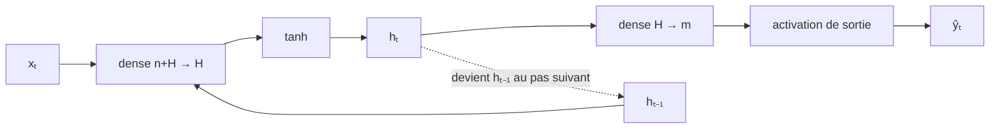

#ml-1

# Définition

La cellule d'Elman est le cas le plus simple du [[Réseau récurrent]] : une seule couche cachée récurrente, dont l'état est transmis d'un pas au suivant. La fonction de récurrence $f : (x_t, h_{t-1}) \mapsto (\hat{y}_t, h_t)$ s'y scinde en deux parties.

La mise à jour $u : (x_t, h_{t-1}) \mapsto h_t$ est une couche dense appliquée aux deux entrées, suivie d'une tangente hyperbolique :

$$h_t = \tanh(W_x x_t + W_h h_{t-1} + b)$$

avec $W_x$ la matrice des poids des entrées, $W_h$ celle des poids de l'état et $b$ le biais.

La sortie $o : h_t \mapsto \hat{y}_t$ est la dernière couche usuelle, qui ne fait que formater la sortie : une couche linéaire, puis une sigmoïde, un softmax ou aucune activation. C'est la couche cachée qui porte la représentation, voir [[Première et dernière couches]] pour le choix de l'activation de sortie.

# Propriétés

Un pas de la cellule est un [[Perceptron multicouche|perceptron multicouche]] à une couche cachée, dont la couche cachée est aussi transmise au pas suivant.

Les deux produits matriciels de la mise à jour se regroupent en une seule couche appliquée à la concaténation des deux entrées :

$$W_x x_t + W_h h_{t-1} = W [x_t ; h_{t-1}]$$

où $W$ est formée en plaçant côte à côte les colonnes de $W_x$ et celles de $W_h$.

La mise à jour $u$ s'écrit donc comme une seule couche `nn.Linear(n + H, H)`, de $n$ entrées et $H$ unités cachées, appliquée à la concaténation de $x_t$ (de taille $n$) et de $h_{t-1}$ (de taille $H$).

La concaténation se fait avec `torch.cat`, qui colle des tenseurs le long d'un axe existant : les autres axes doivent coïncider d'un tenseur à l'autre (voir [[Forme d'un tenseur]]).

La tangente hyperbolique borne l'état dans $(-1, 1)$, ce qui est la [[Fonctions d'activation|fonction d'activation]] de la couche cachée.

# Exemple

Le schéma de la cellule sépare la mise à jour $u$ du formatage de sortie $o$.



Un pas sur un lot de $B$ séquences, avec $n$ entrées et $H$ unités cachées :

```python
x_t = torch.randn(B, n)          # un pas, un lot
h = torch.zeros(B, H)            # h_0
xh = torch.cat((x_t, h), dim=1)  # (B, n + H)

cell = nn.Linear(n + H, H)
h = torch.tanh(cell(xh))         # (B, H) : h_1
```

L'état initial $h_0$ est un vecteur nul. Il suffit de répéter ce pas pour chaque $t$ pour obtenir un réseau récurrent complet.

# Remarque

La cellule d'Elman est le point de départ dont les cellules à portes sont des généralisations : [[Mémoire à long et court terme]] et [[Unité récurrente à portes]] ajoutent des portes qui dosent ce qui est écrit, conservé et montré.

Son entraînement passe par le dépliage de la boucle sur les pas du temps, voir [[Rétropropagation dans le temps]] : les mêmes poids sont réutilisés à chaque pas, donc le gradient d'un poids est la somme de ses contributions sur tous les pas.
