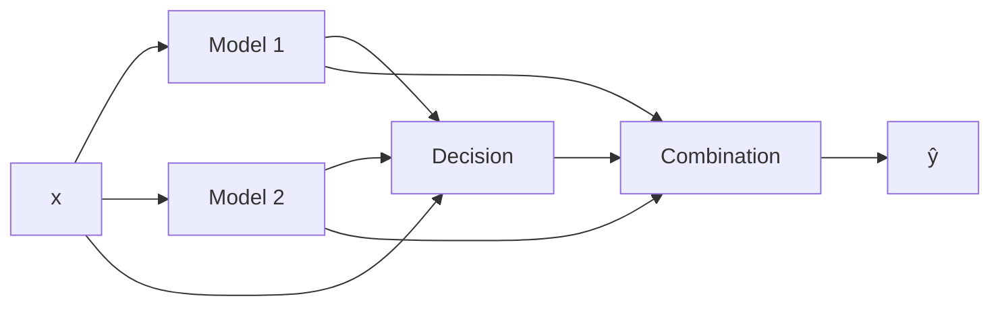

#ml-3

# Définition

La combinaison de modèles fait coopérer plusieurs modèles entraînés séparément : une **décision** observe la situation et une **combinaison** agrège les sorties des modèles pour produire la prédiction finale.

Deux modèles sont disponibles pour faire des choses différentes.

La décision fournit par exemple la probabilité $\Pr(\text{use Model 1})$.

La combinaison retient alors l'une des deux sorties, ou en fait une moyenne pondérée.

# Modèle

L'entrée $x$ alimente en parallèle **Model 1** et **Model 2**, et parvient aussi directement à **Decision**.

Les sorties des deux modèles remontent à la fois vers **Decision** et vers **Combination**, et Decision transmet son signal à Combination.

Combination produit la sortie finale $\hat{y}$.

## Deux modèles

Avec deux modèles et une décision $p = \Pr(\text{utiliser le modèle 1})$, la sortie combinée vaut

$$\hat{y} = p\,\hat{y}^{(1)} + (1-p)\,\hat{y}^{(2)}$$

où la décision est elle-même une fonction apprise de $\mathbf{z}$ :

$$p = \sigma(\mathbf{w}\cdot\mathbf{z} + b) \in [0,1]$$

Le vecteur $\mathbf{z} \in \mathbb{R}^{n}$ est ce que la décision regarde : l'entrée $\mathbf{x}$, éventuellement les sorties des modèles.

## $M$ modèles

Avec $M$ modèles, chaque modèle reçoit un poids $g_m$ et

$$\hat{y} = \sum_{m=1}^{M} g_m\,\hat{y}^{(m)}$$

Les poids forment un vecteur de scores normalisé par la [[Fonction softmax]] :

$$\mathbf{g} = [g_1,\dots,g_M] = \operatorname{softmax}(W\mathbf{z}+\mathbf{b})$$

La matrice $W \in \mathbb{R}^{M\times n}$ et le biais $\mathbf{b} \in \mathbb{R}^{M}$ fournissent un score par modèle.

# Interprétation

La pondération des modèles a la même forme que celle de l'attention : dans [[Attention dans un encodeur-décodeur]], le vecteur de contexte pondère les positions de l'entrée,

$$c_t = \sum_i (\mathbf{a}_t \otimes \mathbf{h})_i = \sum_{i=1}^{N} a_i h_i$$

et ici la sortie pondère les modèles :

$$\hat{y} = \sum_m (\mathbf{g}\otimes\hat{Y})_m$$

où $\hat{Y} = [\hat{y}^{(1)},\dots,\hat{y}^{(M)}]$ rassemble les sorties des modèles.

Les poids $\mathbf{a}_t$ portent sur les positions, les poids $\mathbf{g}$ portent sur les modèles.

Cette même forme de pondération à $M$ modèles est le cadre du [[Mélange d'experts]].

# Remarque

Le [[Mécanisme de copie]] est un cas particulier de cette combinaison à deux modèles : l'un génère un mot du vocabulaire, l'autre le copie depuis l'entrée, et une décision pondère leurs deux distributions.
