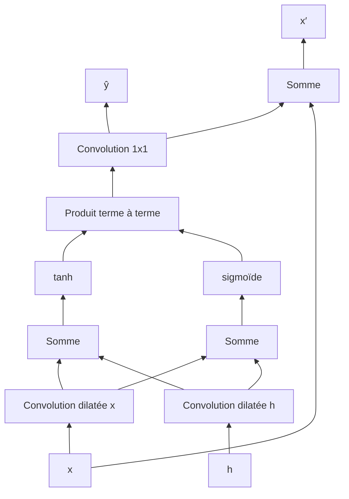

#ml-2

# Modèle

Le modèle autorégressif conditionné factorise la probabilité jointe de la forme d'onde en produit de probabilités conditionnelles, en conditionnant chaque échantillon sur le passé audio **et** sur une variable de conditionnement $\mathbf{h}$, par exemple l'identité du locuteur :

$$p(\mathbf{x} \mid \mathbf{h}) = \prod_{t=1}^{T} p(x_t \mid x_1, \dots, x_{t-1}, \mathbf{h})$$

Le conditionnement ne se réduit pas à une entrée supplémentaire : $\mathbf{h}$ est injecté à chaque couche, dans chaque [[Unité résiduelle de WaveNet|unité résiduelle]] de l'[[Architecture WaveNet]].

Dans une unité, l'architecture du conditionnement s'organise ainsi :

- deux blocs de [[Convolution dilatée|convolution dilatée]] reçoivent l'un l'audio $\mathbf{x}$, l'autre le conditionnement $\mathbf{h}$, avec des connexions croisées entre les deux branches ;
- les sorties des deux branches sont combinées dans une somme, une branche passant par une $\tanh$ et l'autre par une sigmoïde ;
- les deux branches sont multipliées terme à terme : c'est l'activation par gating, qui module le signal ;
- une nouvelle somme, puis une convolution $1 \times 1$, produisent $\hat{\mathbf{y}}$ ;
- la [[Connexions résiduelles|connexion résiduelle]] réinjecte $\mathbf{x}$ en sortie pour donner $\mathbf{x}'$, ce qui permet d'empiler de nombreuses couches.

# Définition

Le conditionnement prend deux formes, selon que $\mathbf{h}$ varie ou non au cours du temps.

Conditionnement global : un vecteur $\mathbf{h}$ unique pour tout le signal, par exemple l'identité du locuteur, le même à chaque pas de temps.

Conditionnement local : une série temporelle $\mathbf{h}$ plus lente que l'audio, par exemple des traits linguistiques ou un [[Spectrogramme mel]], suréchantillonnée au rythme de l'audio par convolution transposée ou par répétition.

Dans les deux cas, $\mathbf{h}$ entre dans chaque unité résiduelle.

# Propriétés

Conditionnement global, avec un vecteur $\mathbf{h}$ identique à chaque pas de temps :

$$\mathbf{z} = \tanh\left(W_{f,k} * \mathbf{x} + V_{f,k}^{\top}\mathbf{h}\right) \odot \sigma\left(W_{g,k} * \mathbf{x} + V_{g,k}^{\top}\mathbf{h}\right)$$

Conditionnement local, avec une série $\mathbf{h}$ alignée sur le temps :

$$\mathbf{z} = \tanh\left(W_{f,k} * \mathbf{x} + V_{f,k} * \mathbf{h}\right) \odot \sigma\left(W_{g,k} * \mathbf{x} + V_{g,k} * \mathbf{h}\right)$$

- $*$ : opérateur de convolution ;
- $\odot$ : produit terme à terme ;
- $k$ : indice de la couche ;
- $W_{f,k}$ : filtre de la branche $\tanh$ ;
- $W_{g,k}$ : filtre de la branche porte, dont la sortie passe par la sigmoïde $\sigma$ ;
- $V_{f,k}$ et $V_{g,k}$ : paramètres du conditionnement, une matrice appliquée à $\mathbf{h}$ dans le cas global, un filtre de convolution dans le cas local.

Dans le cas local, $V * \mathbf{h}$ est une convolution $1 \times 1$, appliquée à $\mathbf{h}$ préalablement suréchantillonné au rythme des échantillons audio.

Sans conditionnement, l'activation à porte se réduit à la forme de l'unité résiduelle ordinaire :

$$\mathbf{z} = \tanh(W_{f,k} * \mathbf{x}) \odot \sigma(W_{g,k} * \mathbf{x})$$

# Interprétation

Un **seul** réseau entraîné peut ainsi générer plusieurs voix : le même modèle reproduit l'anglais américain, le locuteur 7 ou le locuteur 10 selon le $\mathbf{h}$ fourni. Le conditionnement global agit donc comme un sélecteur de style ou d'identité fixé pour toute la génération, tandis que le conditionnement local pilote le contenu au fil du temps, par exemple la suite de phonèmes à prononcer.

La causalité ne concerne que $\mathbf{x}$ : $\mathbf{h}$ est connu d'avance, comme la phrase entière à prononcer, et peut être utilisé en entier sans attendre les pas de temps futurs. Le conditionnement n'impose donc aucun masque causal sur la branche $\mathbf{h}$.

Le suréchantillonnage est nécessaire parce qu'une trame de $\mathbf{h}$ couvre plusieurs centaines d'échantillons audio : répéter ou étirer $\mathbf{h}$ au rythme de l'audio aligne les deux échelles de temps, condition indispensable pour additionner les deux branches dans chaque unité.

# Remarque

Dans le cas local, la convolution $1 \times 1$ $V * \mathbf{h}$ traite chaque position temporelle indépendamment : elle ne mélange que les canaux de $\mathbf{h}$ à un instant donné, sans franchir les pas de temps. L'alignement temporel entre $\mathbf{h}$ et $\mathbf{x}$ doit donc être établi en amont par le suréchantillonnage.
