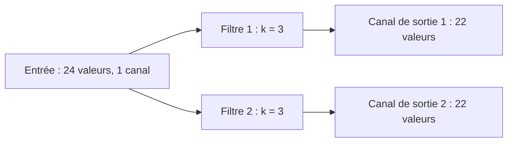

#ml-2

# Définition

Une convolution en une dimension prend une suite de $N$ éléments de même type et un noyau de taille $k$ :

- $\mathbf{x} = (x_1, \dots, x_N)$ : suite de $N$ éléments de même type ;
- $k$ : taille du noyau ;
- $\mathbf{w} = (w_1, \dots, w_k)$ : poids du noyau ;
- $b$ : biais ;
- $\mathbf{w}$ et $b$ sont des paramètres apprenables ;
- $\mathbf{y} = \mathbf{x} * \mathbf{w}$ : convolution de $\mathbf{x}$ par $\mathbf{w}$.

$$y_i = \sum_{j=1}^{k} w_j\, x_{i+j-1} + b$$

pour $i$ allant de $1$ à $N - k + 1$.

# Interprétation

Une fenêtre de taille $k$ glisse sur $\mathbf{x}$, toujours avec les **mêmes** poids $\mathbf{w}$ : les paramètres sont partagés entre toutes les positions de la suite. Chaque sortie $y_i$ agrège ainsi l'information locale autour de $x_i$.

Les éléments d'entrée doivent être du même type, ce qui est le cas des [[Données séquentielles|données séquentielles]] comme une série temporelle. Dans un réseau, les noyaux sont les paramètres appris par une [[Couche de convolution]].

# Exemple

### Température horaire

Entrée : la température pour chaque heure. Toutes les entrées sont du même type, une série. Pour un noyau de taille $3$ appliqué aux trois premières valeurs :

$$y = w_1 x_1 + w_2 x_2 + w_3 x_3$$

Schéma : une série verticale de cases jaunes, dont les trois premières sont encadrées en bleu et connectées aux poids $w_1$, $w_2$, $w_3$ ; la somme pondérée est calculée dans un nœud bleu, puis produit une sortie unique, une case rose. Le principe illustré est celui de la convolution en une dimension : une fenêtre glissante de $3$ valeurs d'entrée, pondérées puis sommées, donne une valeur de sortie.

Le noyau lui-même est une suite de $3$ cases qui glisse le long de l'entrée selon une fenêtre glissante ; chaque position du noyau produit une case de sortie. Avec $k = 3$, un canal d'entrée et un canal de sortie, la sortie est une suite de même nature que l'entrée, de longueur réduite.

### Deux filtres sur une entrée de longueur 24

| Élément | Valeur |
| --- | --- |
| Longueur d'entrée | $24$ |
| Taille du filtre $k$ | $3$ |
| Canaux d'entrée | $1$ |
| Canaux de sortie | $2$ |
| Dimensions de sortie | $22 \times 2$ |

Chaque position de sortie agrège $k = 3$ valeurs d'entrée consécutives. Avec un seul canal d'entrée et deux filtres distincts, on obtient deux canaux de sortie de longueur $24 - 3 + 1 = 22$.

# Propriétés

Chaque position de sortie agrège $k$ valeurs d'entrée consécutives, d'où la longueur de sortie, détaillée dans [[Taille de sortie d'une convolution]] :

$$L_{out} = L_{in} - k + 1$$

Avec un seul canal d'entrée et $C$ filtres distincts, la sortie compte $C$ canaux, chacun de longueur $L_{in} - k + 1$ : la forme de sortie est $(L_{in} - k + 1) \times C$.

Les poids du noyau sont partagés entre toutes les positions : c'est la même fenêtre pondérée qui est appliquée d'un bout à l'autre de la suite.
