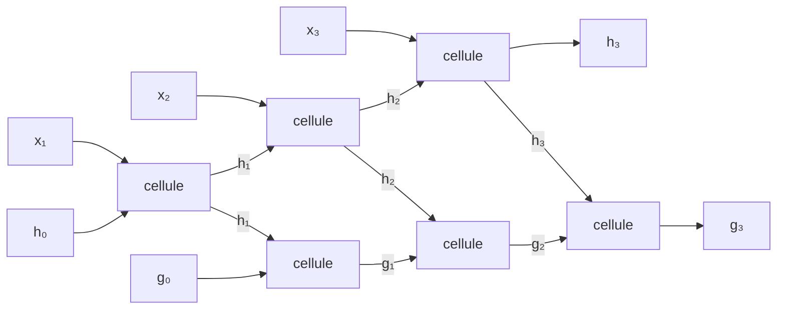

#ml-1

# Définition

Le module `nn.RNN` de PyTorch exécute en C++ la boucle d'un [[Réseau récurrent]], c'est-à-dire la [[Cellule d'Elman]] répétée sur l'axe du temps avec les mêmes poids à chaque pas. Il se construit avec quatre paramètres, dont deux obligatoires `n` et `H` :

```python
rnn = nn.RNN(n, H, num_layers=1, batch_first=False)
```

- `n` : la taille de l'entrée à chaque pas ;
- `H` : la taille de l'état caché ;
- `num_layers` : le nombre de couches récurrentes empilées ;
- `batch_first` : l'ordre des deux premiers axes de l'entrée $x$ et de la séquence de sortie `all_h` ; $h_0$ et `h_T` restent en $(\text{layers}, B, H)$.

Le module ne calcule que la cellule récurrente $u : (x_t, h_{t-1}) \mapsto h_t$. La sortie $o : h_t \mapsto \hat{y}_t$ reste à ajouter, avec un `nn.Linear` personnel (voir [[Composer un réseau avec PyTorch]]).

Le module porte deux biais, $b_{ih}$ sur les entrées et $b_{hh}$ sur l'état, là où un seul biais suffirait : c'est $H$ poids de plus qu'une cellule écrite à la main.

# Propriétés

L'appel reçoit la séquence $x$ et l'état initial $h_0$ et rend la séquence des états et le dernier état. Pour $n = 10$ entrées, $H = 20$ unités cachées, un lot de $B = 3$ séquences de $T = 5$ pas et une seule couche :

```python
x = torch.randn(5, 3, 10)     # (T, B, n): time first
h0 = torch.zeros(1, 3, 20)    # (layers, B, H)
all_h, h_T = rnn(x, h0)       # h0 omitted: zeros
all_h.shape   # (5, 3, 20): h_1, ..., h_T
h_T.shape     # (1, 3, 20): the last one only
```

- l'entrée est de forme $(T, B, n)$, l'axe du temps en premier ;
- l'état initial est de forme $(\text{layers}, B, H)$ ;
- `all_h` est de forme $(T, B, H)$ et contient $h_1, \dots, h_T$ ;
- `h_T` est de forme $(\text{layers}, B, H)$ et ne contient que le dernier état ;
- omis, $h_0$ vaut le tenseur nul.

Les tailles suivent le même ordre d'axes que tout tenseur, voir [[Forme d'un tenseur]].

Avec `batch_first=True`, $x$ et `all_h` passent en $(B, T, \cdot)$ : le drapeau ne concerne que les tenseurs qui portent l'axe du temps en premier.

Pour une sortie unique par séquence (many to one) dans l'ordre par défaut, `all_h[-1]` et `h_T[-1]` sont le même $h_T$, le dernier état : c'est lui qui alimente $o$. Avec `batch_first=True`, `all_h` est en $(B, T, H)$ et le dernier pas s'obtient par `all_h[:, -1]`.

Les sorties ont toujours la taille cachée $H$, quelle que soit la taille d'entrée $n$.

Avec `num_layers=2`, les couches sont empilées : la séquence $h_1, \dots, h_T$ produite par la première couche devient la séquence d'entrée de la seconde, et la sortie du module est la séquence de la couche du haut. Le dernier état est rendu une fois par couche.

| module | état transporté | poids |
| --- | --- | --- |
| `nn.RNN` | $h$ | référence |
| `nn.LSTM` | le couple $(h, c)$ | 4 fois ceux de `nn.RNN` |
| `nn.GRU` | $h$ | 3 fois ceux de `nn.RNN` |

Le facteur vient du nombre de couches denses : quatre pour la [[Mémoire à long et court terme]] (trois portes et le contenu candidat $\tilde{c}_t$), trois pour l'[[Unité récurrente à portes]] (deux portes et le candidat $\tilde{h}_t$).

# Exemple

Deux couches empilées, avec un état initial par couche :

```python
rnn = nn.RNN(10, 20, num_layers=2)
h0 = torch.zeros(2, 3, 20)      # one h_0 per layer
all_g, h_T = rnn(x, h0)
all_g.shape    # (5, 3, 20): g_1, ..., g_T, top layer
h_T.shape      # (2, 3, 20): h_T and g_T
```

Le schéma des deux couches enchaîne les cellules couche par couche : chaque sortie de la couche du bas est l'entrée correspondante de la couche du haut.



La mémoire à long et court terme et l'unité récurrente à portes gardent la même interface que `nn.RNN` : la seconde transporte seulement un état de plus, que l'on passe sous forme de couple.

```python
lstm = nn.LSTM(10, 20)
h0, c0 = torch.zeros(1, 3, 20), torch.zeros(1, 3, 20)
all_h, (h_T, c_T) = lstm(x, (h0, c0))
all_h.shape   # (5, 3, 20): size H, not n

gru = nn.GRU(10, 20)
all_h, h_T = gru(x, h0)          # as nn.RNN
```

Passer de la cellule simple à la mémoire à long et court terme se limite donc à remplacer `nn.RNN` par `nn.LSTM` et à fournir le couple d'états initiaux.

# Remarque

Le choix de la cellule ne change pas la forme des sorties : elles restent en $H$, alors que l'entrée est en $n$.

Le coût en paramètres suit le nombre de couches denses : quatre pour la mémoire à long et court terme, trois pour l'unité récurrente à portes, contre une pour `nn.RNN`.

Un lot n'accepte qu'un tenseur, donc des séquences de même longueur : le [[Longueur variable des séquences|remplissage]] des séquences courtes précède tout appel à ces modules.
