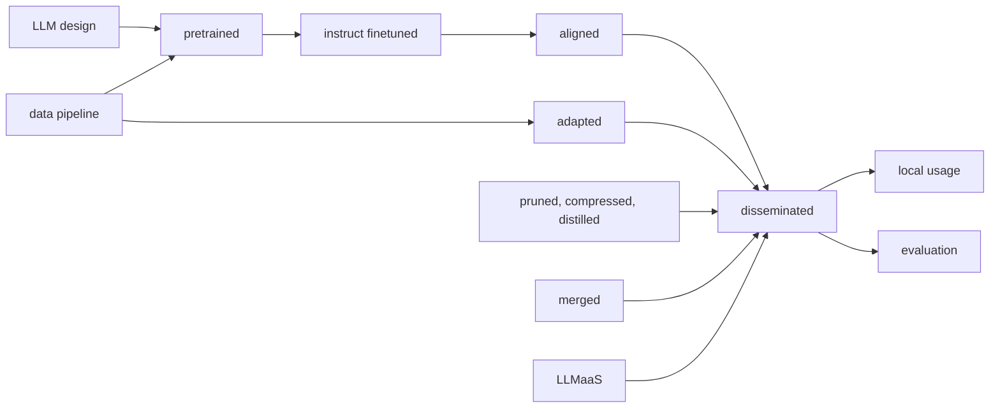

#ml-3

# Modèle

Le cycle de vie d'un grand modèle de langage enchaîne la conception, l'entraînement, le post-entraînement, la diffusion, puis l'usage et l'évaluation. Les étapes principales sont:

- la conception du modèle (*LLM design*), contrainte par le biais inductif de l'architecture et par les lois d'échelle;
- l'obtention d'un modèle pré-entraîné (*pretrained*), qui demande parallélisme, optimisations et outillage;
- le post-entraînement, qui mène du modèle pré-entraîné à un modèle affiné sur instructions (*instruct finetuned*), puis à un modèle aligné (*aligned*);
- la diffusion (*disseminated*), d'où partent l'usage local et l'évaluation.

Un pipeline de données alimente le modèle pré-entraîné et les modèles adaptés; il couvre la collecte, la curation et la génération de données synthétiques.

Les contraintes de conception et le paysage des modèles disponibles sont détaillés dans [[État de l'art des grands modèles de langage]].

# Algorithme

Quatre voies mènent à un modèle diffusé, en plus de la chaîne principale:

- adaptation du modèle pré-entraîné par affinage (*FT*), par affinage efficace en paramètres (*PEFT*) ou par apprentissage continu (*CL*);
- élagage, compression ou distillation, avec [[Taille de stockage des poids|quantification des poids]] et optimisation;
- fusion de modèles (*merged*);
- service de modèle de langage (*LLMaaS*), avec des outils comme *llama.cpp*, *ollama*, les *llamafiles* ou *vllama*.

La mise à disposition des modèles s'appuie sur les outils de publication et d'inférence décrits dans [[Pipeline Hugging Face]].

# Interprétation

Les deux débouchés d'un modèle diffusé se distinguent par leur finalité:

| Étape | Contenu |
|---|---|
| Usage local | apprentissage zero-shot (ZSL), apprentissage en contexte (ICL), *prompting*, génération de données, RAG, agents |
| Évaluation | perplexité, benchmarks, contamination, juge automatique (*LLM-judge*), coût carbone |

L'usage local regroupe les modes d'exploitation directe du modèle: ZSL et ICL (apprentissage sans exemple et apprentissage en contexte), *prompting*, génération de données, RAG et agents.

L'évaluation mesure la qualité du modèle par sa perplexité et par des benchmarks, contrôle la contamination des jeux de test, recourt à un juge automatique et comptabilise le coût carbone, dont l'ordre de grandeur est traité dans [[Empreinte environnementale de l'intelligence artificielle]].
