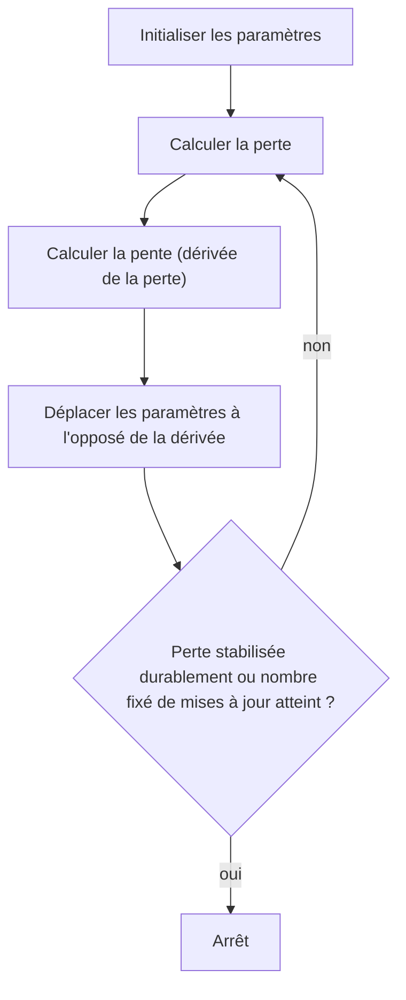

#ml-1

# Définition

La descente de gradient est une méthode d'optimisation itérative : le principe est de suivre la pente de la fonction de perte vers le bas, jusqu'au meilleur paramètre.

L'erreur d'un modèle est une fonction mathématique de ses paramètres, et la pente de cette fonction est sa dérivée. Apprendre le modèle revient donc à chercher les paramètres qui minimisent la perte sur les données observées, comme pour la [[Régression linéaire]] :

$$(a^*, b^*) = \operatorname*{argmin}_{(a,b)} L(a, b)$$

# Algorithme

1. Initialiser les paramètres.
2. Calculer la perte.
3. Calculer la pente (dérivée de la perte).
4. Déplacer les paramètres à l'opposé de la dérivée.
5. Revenir à l'étape 2, jusqu'à ce que
   - la perte cesse de s'améliorer durablement,
   - ou qu'un nombre fixé de mises à jour soit atteint.

# Propriétés

De combien faut-il déplacer les paramètres ? Le taux d'apprentissage, ou pas d'apprentissage, $\alpha$, fixe l'amplitude du déplacement :

- trop petit, l'apprentissage prend un temps interminable ;
- trop grand, le déplacement dépasse l'optimum et peut diverger.

C'est l'hyperparamètre le plus pénible à régler. Il se règle sur le jeu de [[Jeux d'entraînement, de développement et de test|développement]], jamais sur le jeu de test.

La dérivée de la perte par rapport au paramètre est notée $\frac{\partial L}{\partial a}(a_t)$. La mise à jour s'écrit

$$a_{t+1} \leftarrow a_t - \alpha \times \frac{\partial L}{\partial a}(a_t)$$

- Plus la pente est raide, plus le déplacement est grand.
- Le signe moins est ce qui fait de la règle une descente.
- $\alpha$ règle la vitesse globale de l'apprentissage.
- Avec plusieurs paramètres, une règle de ce type s'applique à chaque paramètre : le vecteur de toutes les dérivées partielles est le gradient.

Pour trois paramètres et l'opposé de la log-vraisemblance pris pour perte, la mise à jour se fait en un seul pas vectoriel :

$$\nabla(-LL)(a_t, b_t, c_t) = \left( \frac{\partial(-LL)}{\partial a}, \frac{\partial(-LL)}{\partial b}, \frac{\partial(-LL)}{\partial c} \right)(a_t, b_t, c_t)$$

$$(a_{t+1}, b_{t+1}, c_{t+1}) = (a_t, b_t, c_t) - \alpha \times \nabla(-LL)(a_t, b_t, c_t)$$

Un outil de [[Différenciation automatique|différenciation automatique]] calcule le vecteur complet. Reste la question de l'origine de $\frac{\partial L}{\partial a}$ : c'est le [[Graphe de calcul]] qui en organise le calcul.

# Exemple

Calcul à la main, comme on le ferait sur papier : on écrit $L$, puis on dérive. Pour trois points, la perte quadratique vaut

$$L(a, b) = \sum_i (a x_i + b - y_i)^2$$

$$= (a+b-1)^2 + (2a+b-4)^2 + (4a+b-7)^2$$

En développant :

$$L(a, b) = 21a^2 + 14ab + 3b^2 - 74a - 24b + 66$$

On dérive une fois par paramètre, puis on évalue au point initial $(a_0, b_0) = (1, 1)$ :

$$\frac{\partial L}{\partial a} = 42a + 14b - 74 \longrightarrow -18$$

$$\frac{\partial L}{\partial b} = 14a + 6b - 24 \longrightarrow -4$$

Vérification : en posant $b = 0$, on retrouve $21a^2 - 74a + 66$, la courbe déjà tracée.

Les valeurs $-18$ et $-4$ sont les composantes du gradient au point initial.

# Remarque

- La boucle est parfois énoncée sans taux d'apprentissage, avec un arrêt dès qu'il n'y a plus d'amélioration ; la version complète retient un taux $\alpha$ et deux conditions d'arrêt, la stagnation durable ou un nombre fixé de mises à jour.
- La même descente résout d'autres problèmes d'optimisation : pour la régression logistique, on minimise l'opposé de la log-vraisemblance, toujours par descente de gradient, avec le même algorithme et une perte différente.
- La méthode s'applique à toute perte dérivable, par exemple la [[Perte absolue et perte quadratique|perte quadratique]] utilisée dans l'exemple.
- La règle de base est raffinée par les [[Optimiseurs]].
