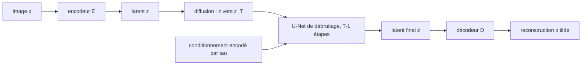

#ml-2

# Définition

La diffusion latente applique le processus d'un [[Modèle de diffusion]] non pas dans l'espace des pixels mais dans l'espace latent compact d'un [[Auto-encodeur]] :

- l'encodeur $\mathcal{E}$ projette l'image $x$ de l'espace pixel vers une représentation latente $z = \mathcal{E}(x)$ ;
- la diffusion puis le débruitage par U-Net opèrent dans cet espace latent ;
- le décodeur $\mathcal{D}$ reconstruit l'image $\tilde{x} = \mathcal{D}(z)$ à partir de la représentation latente.

L'espace pixel et l'espace latent ont ainsi des rôles disjoints : la génération se déroule entièrement en latent, les pixels n'intervenant qu'à l'entrée et à la sortie.

# Modèle

Les deux espaces et les objets qui y circulent :

- espace pixel : image d'entrée $x$, encodeur $\mathcal{E}$, sortie latente $z$, décodeur $\mathcal{D}$, reconstruction $\tilde{x}$ ;
- espace latent : étape de diffusion $z \rightarrow z_T$, débruitage par U-Net $\epsilon_\theta$, boucle itérative répétée $T-1$ fois, états latents $z_T, \dots, z_{T-1}, \dots, z$.

Le U-Net de débruitage $\epsilon_\theta$ est composé de :

- blocs d'attention avec les matrices $Q$, $K$, $V$ ;
- connexions inter-blocs (*skip connections*) ;
- concaténation des sorties ;
- conditionnement injecté par attention croisée.

Le conditionnement accepte plusieurs natures d'entrée, toutes encodées par $\tau_\theta$ avant injection dans l'U-Net :

| Entrée | Type |
|---|---|
| Semantic Map | sémantique |
| Text | texte |
| Representations | latentes |
| Images | visuelles |

# Algorithme

1. Encoder une image dans l'espace latent : $z = \mathcal{E}(x)$.
2. Appliquer le processus de diffusion en latent pour obtenir $z_T$.
3. Débruiter $z_T$ avec le U-Net $\epsilon_\theta$, en répétant l'étape $T-1$ fois : $z_T \rightarrow z_{T-1} \rightarrow \dots \rightarrow z$.
4. Injecter le conditionnement encodé par $\tau_\theta$ dans l'U-Net par attention croisée à chaque étape de débruitage.
5. Décoder l'état latent final : $\tilde{x} = \mathcal{D}(z)$.

# Interprétation

- La diffusion a lieu dans l'espace latent, plus compact que l'espace pixel : le débruitage travaille sur des représentations réduites plutôt que sur l'image complète.
- Le conditionnement (texte, carte sémantique, images) pilote le débruitage par attention croisée : c'est lui qui oriente la génération vers la scène ou le style demandé.
- Le décodeur $\mathcal{D}$ ne sert qu'à la sortie finale : la génération se fait entièrement en latent.

# Exemple

Trois échantillons de scènes produites par un modèle de diffusion :

- un cavalier spatial : un astronaute en combinaison blanche monte un cheval alezan au galop sur un terrain sec, rendu photoréaliste avec ombres et poussière cohérentes ;
- un portrait au turban : homme âgé à barbe longue, turban safran et tunique bleue, fumée légère autour du visage, texture de peau et détail du tissu nets ;
- un paysage nocturne : ciel étoilé aux tourbillons bleus et jaunes au-dessus de montagnes sombres avec une silhouette au premier plan, composition picturale inspirée de Van Gogh.

Le modèle restitue aussi bien des scènes photoréalistes que des styles picturaux, avec une cohérence globale de la composition.

# Remarque

Les connexions inter-blocs d'un U-Net ne sont pas des [[Connexions résiduelles]] : elles relient des blocs situés à des profondeurs différentes et leurs sorties sont concaténées, alors qu'une connexion résiduelle ajoute l'entrée d'un bloc à sa sortie.

Le détail des opérations élémentaires du U-Net, en particulier les [[Couche de convolution|couches de convolution]] qui le constituent, est traité dans leurs notes respectives ; ici, l'architecture se caractérise par ses blocs d'attention $Q, K, V$, ses connexions inter-blocs et l'injection du conditionnement par attention croisée.
