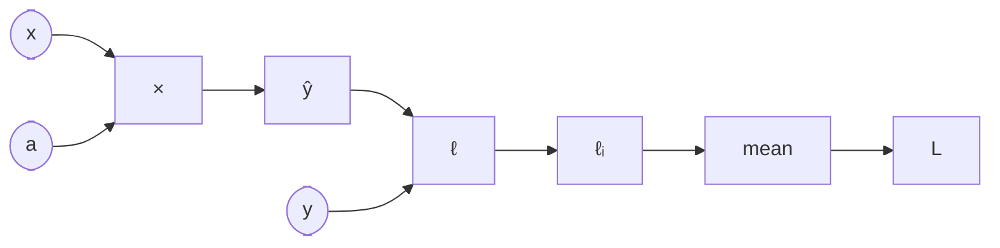

#ml-1

# Définition

La différenciation automatique, ou autograd, calcule les dérivées d'une perte à partir du [[Graphe de calcul]] enregistré pendant la passe avant, sans jamais disposer de la formule analytique de la perte.

PyTorch ne voit pas la formule : il n'a pas de $L(a, b)$ à dériver. Ce qu'il possède, c'est l'enregistrement des opérations qui ont réellement été exécutées. Chaque résultat se souvient de l'opération qui l'a produit et de ce qu'elle a reçu en entrée. Cet enregistrement est le graphe de calcul, et c'est la seule chose que `backward()` peut parcourir.

# Algorithme

Tout cela tient en trois appels.

Marquer les variables dont on veut la dérivée, avec `requires_grad=True` sur un tenseur de [[Tenseurs PyTorch]] :

```
a = torch.tensor([1.0], requires_grad=True)
```

Calculer puis rétropropager le gradient :

```
L.backward()
```

Lire le résultat :

```
a.grad
```

En pratique, on prend la moyenne (`mean`) plutôt que la somme (`sum`). La perte moyenne est indépendante du nombre d'échantillons, donc le taux d'apprentissage $\alpha$ n'a pas à être réajusté quand le jeu de données grandit.



# Interprétation

Deux routes mènent aux mêmes deux nombres, avec des exigences très différentes :

- analytique : il faut $L$ sous la forme d'une formule unique, une dérivation par paramètre, et toute modification du modèle oblige à refaire l'algèbre ;
- backward (autograd) : il suffit de la dérivée locale de chaque opération, une seule passe donne tous les paramètres, et un changement de modèle n'impose rien à refaire.

Ici, les deux routes aboutissent aux mêmes valeurs, $-18$ et $-4$.

Le graphe est un **enregistrement, pas une équation**. Chaque tenseur construit par une opération porte un `grad_fn` ; la passe avant, nœud par nœud, donne exactement les boîtes du dessin, dans l'ordre :

```
z  = a * x  -> MulBackward0
yh = z + b  -> AddBackward0
e  = yh - y -> SubBackward0
l  = e ** 2 -> PowBackward0
L  = l.sum() -> SumBackward0
```

Le graphe est reconstruit à chaque passe avant, d'où l'expression *define by run*. Avec $n$ venant des données, le même code produit une formule différente à chaque exécution :

```
y = x
for _ in range(n):
    y = y * w
```

- $n = 3$ : $y = w^3 x$ et $\partial y/\partial w = 3w^2 x$ ;
- $n = 5$ : $y = w^5 x$ et $\partial y/\partial w = 5w^4 x$.

Il n'y a donc aucune formule à dériver à l'avance, seulement un graphe à enregistrer.

# Remarque

- `L.backward()` parcourt cette chaîne à l'envers, puis **libère** le graphe ; un second appel lève l'erreur *« Trying to backward through the graph a second time »*.
- Le parcours arrière, opération par opération, est détaillé dans [[Rétropropagation]].
- Sans les opérations enregistrées dans le [[Graphe de calcul]], `backward()` n'a rien à parcourir et la différenciation automatique ne peut pas fonctionner.
