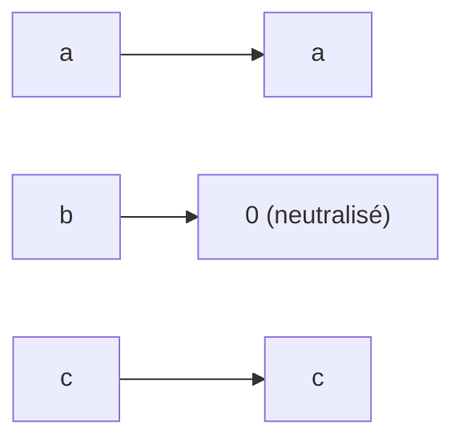

#ml-2

# Définition

Le **dropout** est une couche de régularisation qui dégrade la couche précédente en simulant la perte d'une partie de l'information qu'elle transmet.

- La dégradation n'a lieu qu'à l'entraînement.
- Chaque neurone de la couche précédente est mis à zéro avec une probabilité $p$ fixée à l'avance.
- Un neurone transmet donc sa valeur, ou la valeur $0$.
- La couche ne possède aucun paramètre à optimiser.
- En PyTorch, elle s'écrit `torch.nn.Dropout(drop_prob)`.

À l'inférence, la couche est inactive : toutes les unités transmettent leur valeur intacte. Pour que l'échelle des activations reste la même entre les deux régimes, les unités conservées sont divisées par $1-p$ pendant l'entraînement (dropout inversé), si bien qu'aucune mise à l'échelle n'est nécessaire au moment du test.

# Interprétation

Le dropout injecte un bruit aléatoire à chaque passe d'entraînement : aucun neurone ne peut devenir indispensable, puisque n'importe lequel peut disparaître à la passe suivante.
Le réseau est ainsi contraint de répartir l'information sur plusieurs unités plutôt que de s'appuyer sur une combinaison trop spécifique de quelques-unes.
C'est un mécanisme de régularisation, qui limite le [[Surapprentissage et sous-apprentissage|surapprentissage]] sans ajouter de paramètres.

# Remarque

- La probabilité $p$ est celle d'être **neutralisé** (*dropped*), pas celle d'être conservé : une unité est mise à zéro avec probabilité $p$ et transmise intacte avec probabilité $1-p$. La formulation « probability to be chosen » désigne l'inverse et induit en erreur.
- Le dropout ne se limite pas aux réseaux convolutifs : il s'emploie dans tous les types de réseaux (denses, convolutifs, récurrents, Transformers).
- Comme la [[Normalisation par lots]], la couche se comporte différemment à l'entraînement et à l'inférence : c'est pourquoi la [[Boucle d'entraînement et validation|boucle d'entraînement]] bascule le modèle en mode évaluation avant de mesurer les performances.

# Exemple

Sur une couche de trois neurones, chaque unité peut être neutralisée indépendamment :

Ici $b$ est tombé sur le tirage défavorable, $a$ et $c$ sont conservés. Le tirage est refait à chaque passe : à la passe suivante, ce peut être $a$ ou $c$ qui disparaît.

Dans un modèle complet, la couche se place avant les couches denses de sortie, comme le montre le [[Réseau convolutif avec PyTorch]].
