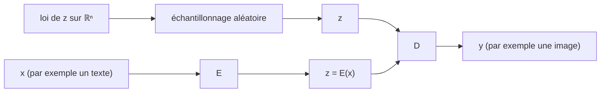

#ml-2

# Définition

Un **décodeur génératif** est un décodeur $D$ appris qui engendre une sortie $\mathbf{y}$ à partir d'une variable latente $\mathbf{z} \in \mathbb{R}^{n}$, tirée au hasard ou calculée par un encodeur.

Dans le premier cas, la variable suit une loi de densité sur $\mathbb{R}^{n}$, souvent la loi normale centrée réduite $\mathcal{N}(0,I)$, où $I$ est la matrice identité. Générer consiste alors à échantillonner $\mathbf{z}$ selon cette loi, puis à lui appliquer le décodeur :

$$\text{densité sur } \mathbb{R}^{n} \text{, souvent } \mathcal{N}(0,I) \;\longrightarrow\; \boxed{\text{échantillonnage aléatoire}} \;\xrightarrow{\ \mathbf{z}\ }\; \boxed{D} \;\longrightarrow\; \mathbf{y}$$

# Interprétation

Le décodeur s'utilise de deux façons, selon l'origine de $\mathbf{z}$.

- **Variable latente aléatoire** : $\mathbf{z}$ est tiré selon la loi choisie sur l'espace latent, sans référence à une entrée. Le décodeur produit alors des sorties nouvelles.
- **Variable latente calculée** : $\mathbf{z} = E(\mathbf{x})$ est la sortie d'un encodeur $E$ qui n'est pas entraîné conjointement avec $D$. Le couple transforme un objet d'une certaine nature en un objet d'une autre nature, un texte en image par exemple.

Dans le premier régime, c'est la loi de $\mathbf{z}$ qui porte la variabilité des sorties ; dans le second, c'est l'entrée $\mathbf{x}$ qui la porte, l'encodeur jouant le rôle d'un simple convertisseur.

# Remarque

Le décodeur génératif est un cas particulier d'[[Encodeur-décodeur]] : la variable latente n'y est pas produite par un encodeur entraîné avec le décodeur, mais tirée au hasard, ou calculée par un encodeur figé.

L'[[Auto-encodeur variationnel]] suit ce principe : son décodeur est un décodeur génératif, alimenté par des variables latentes échantillonnées. La différence avec l'[[Auto-encodeur]] tient à l'entraînement : dans un auto-encodeur, $D$ reconstruit $\mathbf{x}$ à partir de $E(\mathbf{x})$ et les deux réseaux apprennent ensemble ; dans un décodeur génératif, $D$ doit produire une sortie plausible pour tout $\mathbf{z}$ de la loi latente.

La loi de $\mathbf{z}$ fait partie de la définition et non d'un simple détail d'implémentation : elle fixe la répartition des sorties engendrées. Le choix $\mathcal{N}(0,I)$ est le plus courant, mais toute densité sur $\mathbb{R}^{n}$ convient.

Un décodeur génératif est la brique de génération des [[Modèle génératif|modèles génératifs]] à variable latente.

Le processus inverse d'un [[Modèle de diffusion]] se lit comme un décodeur génératif appliqué de façon répétée : chaque étape transforme un état bruité en un état un peu moins bruité, jusqu'à l'échantillon.
