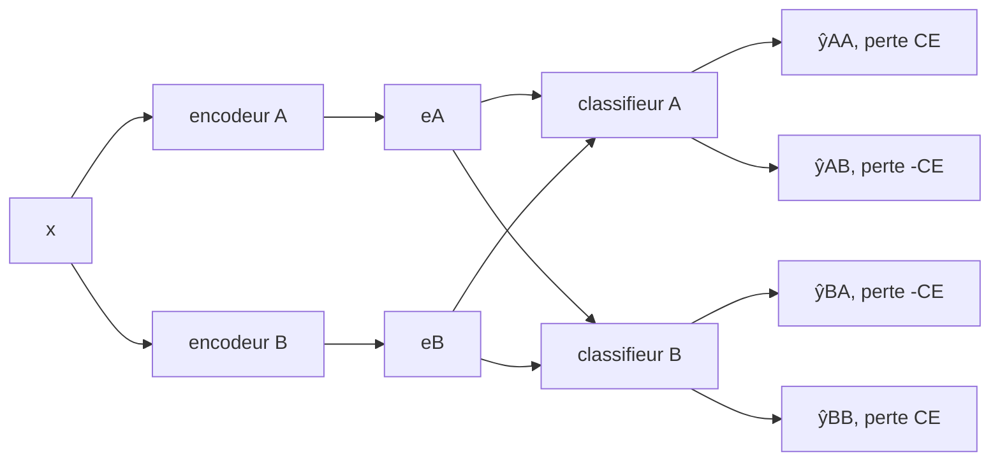

#ml-2

# Définition

Le **désenchevêtrement des représentations** consiste à produire plusieurs représentations d'une même entrée $x$, chacune vouée à un aspect différent de cette entrée. Ces représentations sont des [[Plongement|plongements]] $e_1, \dots, e_N$ calculés à partir du même $x$.

Deux ingrédients accompagnent cette séparation :

- une perte propre à chaque représentation, chacune étant utile à une tâche particulière ;
- des contraintes d'exclusion : l'information portée par une représentation ne peut pas être retrouvée à partir d'une autre.

# Exemple

Séparation de l'avant-plan et de l'arrière-plan d'une image. On suppose une classe pour l'avant-plan, $y_A$, et une classe pour l'arrière-plan, $y_B$.

L'objectif est asymétrique :

- $e_A$ doit permettre de retrouver $y_A$ mais pas $y_B$ ;
- $e_B$ doit permettre de retrouver $y_B$ mais pas $y_A$.

L'entrée $x$ est encodée par deux encodeurs, au sens de l'[[Encodeur-décodeur]] :

- $x \longrightarrow \text{encodeur A} \longrightarrow e_A$
- $x \longrightarrow \text{encodeur B} \longrightarrow e_B$

Chaque représentation passe ensuite dans les deux classifieurs, A et B :

| Représentation | Classifieur | Prédiction | Perte |
|---|---|---|---|
| $e_A$ | A | $\hat{y}_{AA}$ | $\ell_{AA} = \mathrm{CE}(\hat{y}_{AA}, y_A)$ |
| $e_B$ | A | $\hat{y}_{AB}$ | $\ell_{AB} = -\mathrm{CE}(\hat{y}_{AB}, y_A)$ |
| $e_A$ | B | $\hat{y}_{BA}$ | $\ell_{BA} = -\mathrm{CE}(\hat{y}_{BA}, y_B)$ |
| $e_B$ | B | $\hat{y}_{BB}$ | $\ell_{BB} = \mathrm{CE}(\hat{y}_{BB}, y_B)$ |

Les quatre termes se combinent en une perte totale :

$$L = \ell_{AA} + \ell_{AB} + \ell_{BA} + \ell_{BB}$$

# Interprétation

Les deux termes diagonaux $\ell_{AA}$ et $\ell_{BB}$ sont des [[Entropie croisée binaire|entropies croisées]] positives : ils entraînent chaque classifieur à reconnaître sa propre classe depuis la représentation qui lui est destinée. Les deux termes croisés $\ell_{AB}$ et $\ell_{BA}$ sont négatifs : ils poussent au contraire chaque classifieur à échouer sur la représentation de l'autre aspect.

Minimiser $L$ revient donc à rendre $e_A$ porteur de $y_A$ et vide de $y_B$, et réciproquement. C'est la contrainte d'exclusion, mise en œuvre par une perte dont le signe est retourné.

# Remarque

- Le désenchevêtrement prolonge la perte secondaire de l'[[Encodeur-décodeur]] : la contrainte ne porte plus sur une seule représentation intermédiaire, mais sur la répartition de l'information entre plusieurs représentations.
- Le dispositif à plusieurs représentations et plusieurs classifieurs se lit comme un cas d'[[Apprentissage multi-tâches]] : chaque représentation et le classifieur qui lui est associé servent une tâche distincte.
