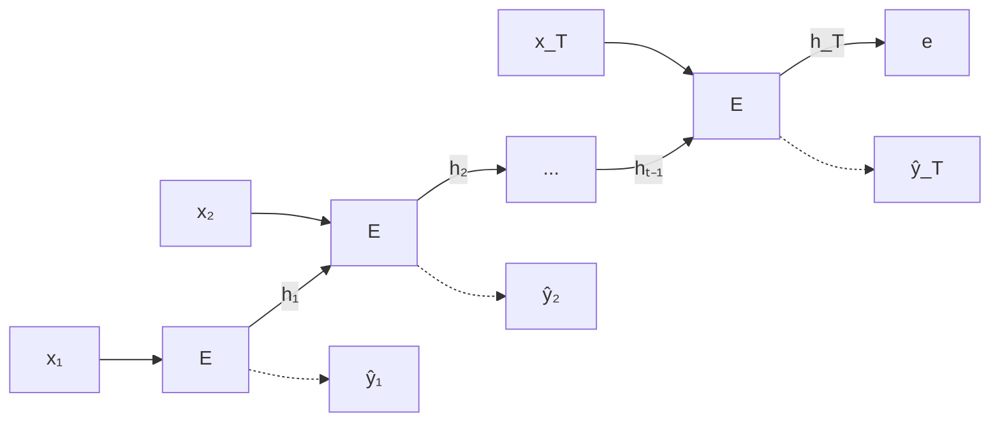

#ml-1

# Définition

Encoder une séquence, c'est la résumer en un **seul vecteur** $e$ : une longueur quelconque entre, une taille fixe sort.

# Modèle

Pour une séquence $x_1, \dots, x_T$ de longueur variable, on fait tourner un [[Réseau récurrent]] sur toute la séquence et on ne garde que son dernier état :

$$e = h_T$$

Avec une [[Mémoire à long et court terme|cellule LSTM]], qui porte deux états, l'encodage est le couple des deux états finaux :

$$e = (h_T, c_T)$$

À chaque pas, le réseau produit aussi une sortie $\hat{y}_t$. Ces sorties, en pointillés sur le schéma, sont calculées puis ignorées : seul l'état final devient $e$.

# Interprétation

$e$ est le [[Plongement|plongement]] de la phrase entière : un vecteur de taille fixe qui en résume le contenu, de la même façon qu'une [[Couche de plongement]] associe un vecteur à un mot.

Une longueur quelconque en entrée, une dimension fixe en sortie : la séquence devient un objet de taille fixe, qui représente la phrase.

# Remarque

Le début de la séquence est mal représenté : pour parvenir dans $e$, l'information du premier élément a traversé $T$ mises à jour, et subit donc la [[Disparition et explosion du gradient|disparition ou l'explosion du gradient]].

Une alternative est de moyenner tous les états au lieu de garder le dernier (**mean pooling**) :

$$e = \frac{1}{T} \sum_{t=1}^{T} h_t$$

Chaque état y compte pour $1/T$.

Cet encodeur lit la séquence dans un seul sens. Pour la lire dans les deux directions, voir [[Encodeur bidirectionnel et causalité]] ; pour enchaîner un encodeur et un décodeur, voir [[Encodeur-décodeur pour les séquences]].
