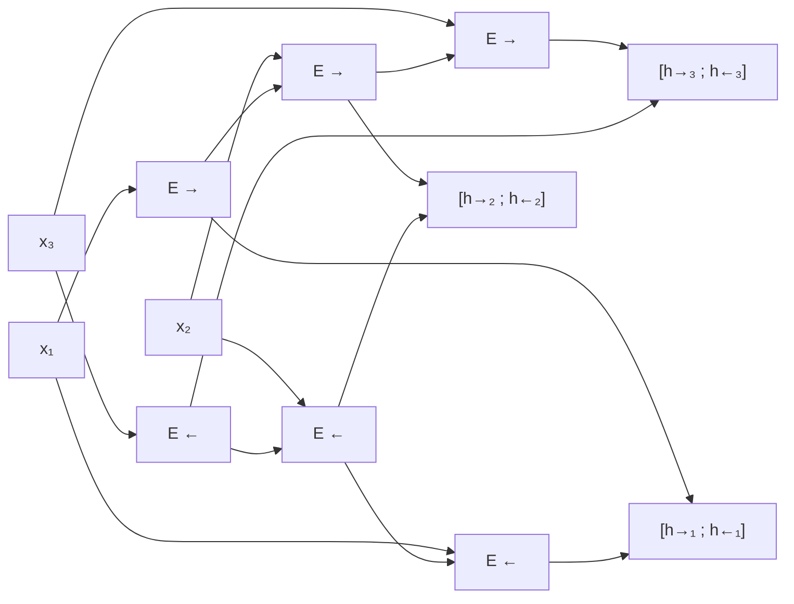

#ml-1

# Définition

Un modèle est **causal** si sa sortie au pas $t$ ne dépend que des entrées $x_1, \dots, x_t$, et jamais des suivantes.

# Modèle

Un **encodeur bidirectionnel** fait tourner deux [[Réseau récurrent|réseaux récurrents]] sur la même séquence : l'un la lit de gauche à droite, l'autre de droite à gauche. Chaque position reçoit la concaténation des deux états cachés :

$$e_t = [\vec{h}_t; \overleftarrow{h}_t]$$

- $\vec{h}_t$ : état du réseau direct après lecture de $x_1, \dots, x_t$ ;
- $\overleftarrow{h}_t$ : état du réseau inverse après lecture de $x_T, \dots, x_t$ ;
- $e_t$ : vecteur de taille $2H$ lorsque l'état caché est de taille $H$.

Sous PyTorch, `nn.RNN(n, H, bidirectional=True)` produit des sorties de taille $2H$.

# Interprétation

Chaque vecteur $e_t$ résume la phrase entière en la centrant sur le mot $t$ : le réseau direct apporte le contexte qui précède, le réseau inverse le contexte qui suit. Chaque extrémité de la phrase est proche de l'un des deux réseaux, si bien que l'information venue du début comme de la fin parcourt peu de pas.

Le résultat est un [[Encodage d'une séquence|encodage de la séquence]] où chaque position dispose d'une vue globale.

# Propriétés

- Un [[Réseau récurrent]] simple est causal : sa sortie au pas $t$ ne dépend que de $x_1, \dots, x_t$, il peut donc tourner en direct, au fil de l'arrivée des données.
- Un encodeur bidirectionnel ne l'est pas : sa sortie au pas $t$ dépend aussi des entrées postérieures.
- Il est donc adapté à l'encodage d'une phrase complète, mais inutilisable pour en produire une, voir [[Génération d'une séquence]].

# Remarque

La distinction causal / non causal ne se limite pas à la récurrence : elle se pose de la même façon pour les modèles bâtis sur l'attention, où BERT n'est pas causal alors que GPT l'est, voir [[Mécanisme d'attention]].
