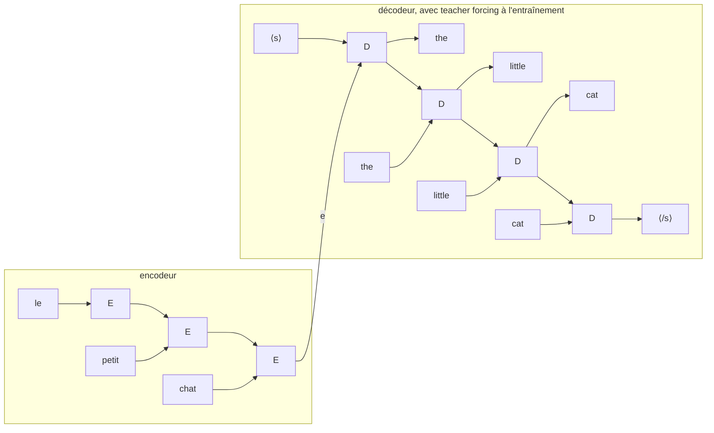

#ml-1 #ml-3

# Définition

Un **encodeur-décodeur pour les séquences** est un [[Encodeur-décodeur]] appliqué à des séquences : l'encodeur résume l'entrée $x$ en un vecteur $e$, et le décodeur génère la sortie $\hat{y}$ à partir de $e$, de façon autorégressive.

Quand $x$ est une séquence, la tâche va d'une séquence à une autre : on parle de **sequence-to-sequence**, ou **seq2seq**.

# Modèle

L'encodeur résume l'entrée (voir [[Encodage d'une séquence]]), puis le décodeur génère la sortie de façon autorégressive (voir [[Génération d'une séquence]]).

Deux manières de fournir $e$ au décodeur $d$ :

- comme état initial : $h_0 = e$ ;
- comme entrée supplémentaire à chaque pas : $(\hat{y}_t, h_t) = d(\hat{y}_{t-1}, e, h_{t-1})$.

Le vecteur unique $e$ décrit l'encodeur récurrent. Dans le Transformer, l'encodeur renvoie un état par position : l'attention croisée du décodeur lit l'ensemble de ces états, et non un vecteur unique.

L'ensemble s'entraîne de bout en bout sur des paires $(x, y)$ : une seule perte, et les deux réseaux apprennent.

Dans l'[[Architecture du Transformer]], l'encodeur et le décodeur sont chacun un empilement de $N$ blocs identiques :

| Bloc | Couches, de haut en bas |
|---|---|
| Encodeur (× $N$) | Attention multi-têtes, Add & Norm, Feed Forward, Add & Norm |
| Décodeur (× $N$) | Attention multi-têtes masquée, Add & Norm, Attention multi-têtes sur la sortie de l'encodeur, Add & Norm, Feed Forward, Add & Norm |
| Tête de sortie | couche linéaire, softmax sur le vocabulaire |

Les tokens d'entrée passent par une [[Couche de plongement]] puis reçoivent un [[Encodage positionnel]] avant d'attaquer la pile d'encodeurs. Côté décodeur, la séquence cible est **décalée d'un cran vers la droite** : elle commence par le token de début $⟨s⟩$, suivi de la cible privée de son dernier token. Le décodeur apprend ainsi à produire chaque token à partir des précédents.

L'attention du décodeur est masquée : la prédiction d'un token ne consulte que les tokens déjà produits, jamais les suivants. La seconde couche d'attention du décodeur, elle, n'est pas masquée et porte sur la sortie de l'encodeur : c'est par elle que la cible en cours de génération reste reliée à l'entrée.

# Exemple

Traduction de « le petit chat » en « the little cat » : l'encodeur lit les trois mots et transmet son état final $e$ au décodeur, qui produit les mots un à un.

À l'entraînement, le décodeur reçoit le mot précédent de la traduction attendue plutôt que sa propre sortie : c'est le [[Teacher forcing]]. À la génération, il réinjecte ce qu'il vient de produire.

Le décalage des entrées et des sorties se lit sur trois lignes :

| Rôle | Tokens |
|---|---|
| Entrée de l'encodeur | Le, petit, chat |
| Entrée du décodeur (sortie décalée) | $⟨s⟩$, The, little |
| Sortie prédite | The, little, cat |

À l'étape représentée, le décodeur dispose de l'entrée encodée « Le petit chat » et de la sortie partielle « The little ». La prédiction du token suivant, « cat », s'appuie sur ces deux sources : l'attention porte à la fois sur les tokens de l'entrée et sur ceux déjà générés.

# Interprétation

Les encodeurs-décodeurs servent dans des tâches variées, qui ne vont pas toutes d'une séquence à une autre :

- traduction automatique : une phrase en entrée, sa traduction en sortie ;
- résumé, dialogue, questions-réponses : du texte en entrée, du texte en sortie ;
- synthèse vocale : du texte en entrée, une séquence de trames audio en sortie ;
- reconnaissance vocale : l'opération inverse ;
- légendes d'images : un encodeur convolutionnel, un décodeur récurrent ;
- plusieurs entrées : un texte, plus quelques secondes de la voix de quelqu'un, donnent ce texte prononcé avec cette voix.

# Remarque

La cible complète de la traduction est « The little cat ». Sur l'étape de génération illustrée, seuls « The little » ont déjà été produits : c'est ce préfixe qui sert d'entrée au décodeur au moment de prédire « cat ».

Un seul vecteur $e$ pour toute une phrase est un **goulot d'étranglement** : l'information de la phrase entière doit tenir dans une taille fixe, et les phrases longues étaient mal traduites.

Le remède est l'**attention**, qui arrive avec le Transformer : voir [[Mécanisme d'attention]].
