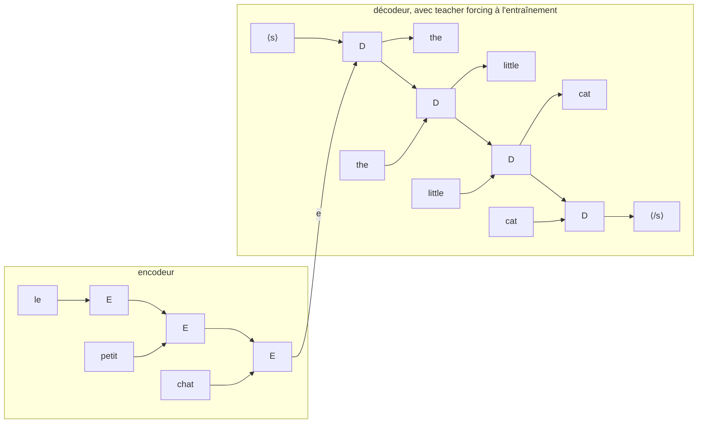

#ml-1

# Définition

Un **encodeur-décodeur pour les séquences** est un [[Encodeur-décodeur]] appliqué à des séquences : l'encodeur résume l'entrée $x$ en un vecteur $e$, et le décodeur génère la sortie $\hat{y}$ à partir de $e$, de façon autorégressive.

Quand $x$ est une séquence, la tâche va d'une séquence à une autre : on parle de **sequence-to-sequence**, ou **seq2seq**.

# Modèle

L'encodeur résume l'entrée (voir [[Encodage d'une séquence]]), puis le décodeur génère la sortie de façon autorégressive (voir [[Génération d'une séquence]]).

Deux manières de fournir $e$ au décodeur $d$ :

- comme état initial : $h_0 = e$ ;
- comme entrée supplémentaire à chaque pas : $(\hat{y}_t, h_t) = d(\hat{y}_{t-1}, e, h_{t-1})$.

L'ensemble s'entraîne de bout en bout sur des paires $(x, y)$ : une seule perte, et les deux réseaux apprennent.

# Exemple

Traduction de « le petit chat » en « the little cat » : l'encodeur lit les trois mots et transmet son état final $e$ au décodeur, qui produit les mots un à un.

À l'entraînement, le décodeur reçoit le mot précédent de la traduction attendue plutôt que sa propre sortie : c'est le [[Teacher forcing]]. À la génération, il réinjecte ce qu'il vient de produire.

# Interprétation

Les encodeurs-décodeurs couvrent toutes les tâches qui vont d'une séquence à une autre :

- traduction automatique : une phrase en entrée, sa traduction en sortie ;
- résumé, dialogue, questions-réponses : du texte en entrée, du texte en sortie ;
- synthèse vocale : du texte en entrée, une séquence de trames audio en sortie ; reconnaissance vocale : l'opération inverse ;
- légendes d'images : un encodeur convolutionnel, un décodeur récurrent ;
- plusieurs entrées : un texte, plus quelques secondes de la voix de quelqu'un, donnent ce texte prononcé avec cette voix.

# Remarque

Un seul vecteur $e$ pour toute une phrase est un **goulot d'étranglement** : l'information de la phrase entière doit tenir dans une taille fixe, et les phrases longues étaient mal traduites.

Le remède est l'**attention**, qui arrive avec le Transformer : voir [[Mécanisme d'attention]].
