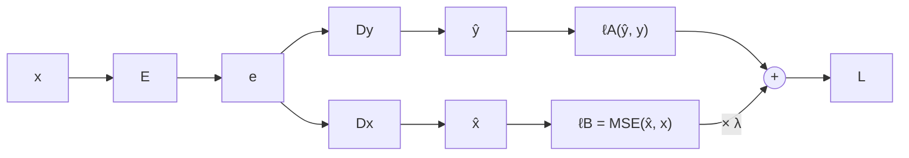

#ml-1

# Définition

Un **encodeur-décodeur** est une architecture formée de deux réseaux enchaînés : un encodeur $E$ transforme l'entrée $x$ en une représentation $e$, puis un décodeur $D$ transforme $e$ en sortie $\hat{y}$.

$$x \longrightarrow \boxed{\text{encodeur } E} \longrightarrow e \longrightarrow \boxed{\text{décodeur } D} \longrightarrow \hat{y}$$

La représentation intermédiaire $e$ est la **variable latente**, aussi notée $z$. C'est elle qui transporte l'information utile de $x$ jusqu'au décodeur.

# Interprétation

L'encodeur-décodeur généralise l'[[Auto-encodeur]] : le décodeur n'a pas à reconstruire $x$, et la sortie vérifie $\hat{y} \ne x$. L'[[Auto-encodeur]] est exactement le cas où le décodeur reconstruit l'entrée, $\hat{y} = x$.

Tout modèle supervisé peut se lire de cette façon :

- $E$ : les couches cachées ;
- $D$ : la ou les dernières couches.

Nommer $e$ variable latente ouvre la porte à de nombreuses architectures : plusieurs pertes, plusieurs décodeurs, plusieurs entrées.

# Propriétés

Un même encodeur peut porter plusieurs pertes. La perte principale mesure la tâche, et une perte secondaire, calculée à partir de $e$, s'y ajoute avec un poids :

$$L = \ell_A + \lambda \, \ell_B$$

- $\ell_A(\hat{y}, y)$ est la perte principale, celle de la tâche.
- $\ell_B$ est la perte secondaire, calculée à partir de $e$.
- $\lambda$ est un [[Hyper-paramètres|hyper-paramètre]] de plus, réglé sur l'ensemble de validation.

Deux choix usuels pour $\ell_B$ :

- **Parcimonie** : $\ell_B = \|e\|_1 = \sum_j |e_j|$, une régularisation qui pousse $e$ à avoir beaucoup de zéros. Peu de dimensions sont actives par entrée, et chacune tend à signifier une seule chose, vers des représentations **désenchevêtrées**.
- **Reconstruction** : $e$ doit encore décrire $x$, et pas seulement la tâche. Un second décodeur reconstruit alors $x$, et $\ell_B = \mathrm{MSE}(\hat{x}, x)$, au sens de l'[[Mesures d'erreur en régression|erreur quadratique moyenne]].

# Exemple

Sur des séquences, l'encodeur résume $x$ en $e$ et le décodeur génère $\hat{y}$ à partir de $e$, de façon autorégressive. Deux manières de fournir $e$ au décodeur :

- comme état initial : $h_0 = e$ ;
- comme entrée supplémentaire à chaque pas : $(\hat{y}_t, h_t) = d(\hat{y}_{t-1}, e, h_{t-1})$.

L'ensemble s'entraîne de bout en bout sur des paires $(x, y)$, avec une seule perte, et les deux réseaux apprennent. Quand $x$ est aussi une séquence, on parle de **sequence-to-sequence** (seq2seq). Voir [[Encodeur-décodeur pour les séquences]].

# Remarque

- Plusieurs décodeurs sur un même encodeur, c'est le cadre de l'[[Apprentissage multi-tâches]].
- Les auto-encodeurs parcimonieux servent à lire les caractéristiques des grands modèles de langage.
