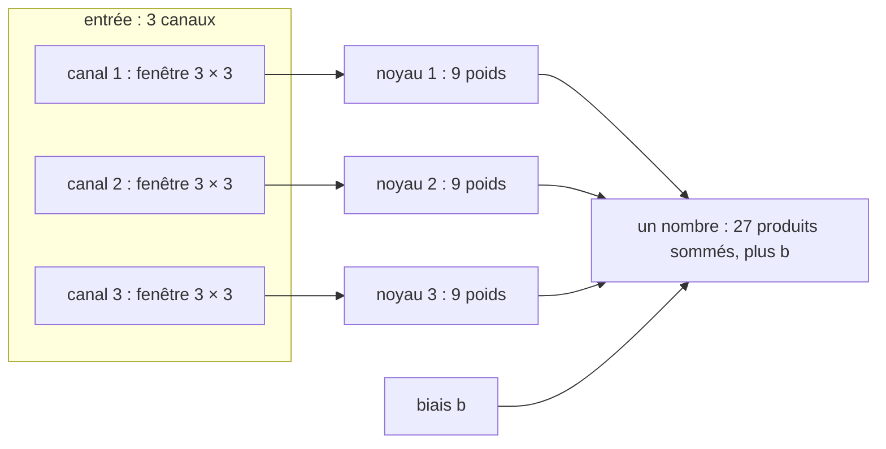

#ml-2

# Définition

Un filtre est un [[Noyau de convolution|noyau]] par canal d'entrée, réunis en un tableau de forme $C \times k_1 \times k_2$, plus un biais $b$. Il traverse l'épaisseur de l'entrée, somme ses réponses sur tous les canaux et produit un nombre par position. Le nombre de filtres d'une couche est le nombre de canaux de sortie.

$$y_{i,j} = \sum_{c=1}^{C} \sum_{u=1}^{k_1} \sum_{v=1}^{k_2} w_{c,u,v} \, x_{c,\, i+u-1,\, j+v-1} + b$$

# Propriétés

- Paramètres d'un filtre : $k_1 k_2 C + 1$, soit un poids par cellule de chaque noyau, plus le biais.
- Un filtre produit une seule [[Carte d'activation]] : les deux objets se correspondent un pour un.
- Les filtres d'une couche sont indépendants : ils ne partagent aucun poids entre eux, seulement leur position et leur taille.
- Deux filtres appliqués à la même entrée donnent deux cartes, empilées en deux [[Canal d'un tenseur|canaux]] de sortie.

# Exemple

Entrée à $3$ canaux, noyau $3 \times 3$, $16$ filtres :

$$16 \times (3 \times 3 \times 3 + 1) = 16 \times 28 = 448$$

paramètres appris. Chaque filtre contient $27$ poids, un par couple (canal, position du noyau), et un biais.

# Remarque

Le mot « filtre » désigne aussi, dans l'usage courant et dans les bibliothèques, le tableau complet des poids d'une couche, de forme $(C_{\text{out}}, C_{\text{in}}, k_1, k_2)$ : chaque filtre y est une tranche du premier axe. Un filtre n'est pas un détecteur arbitraire de motif, mais un produit scalaire avec ses poids, suivi d'une non-linéarité : il répond à ce qui ressemble à son noyau, à un facteur d'échelle près.
