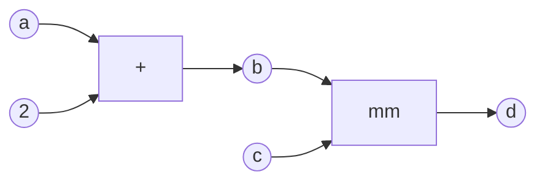
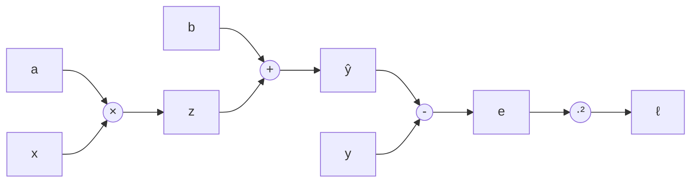

#ml-1

# Définition

Le graphe de calcul d'une expression la décompose en opérations élémentaires et en représente les dépendances. Chaque nœud est une variable, une constante ou le résultat d'une opération, et les arêtes relient les opérandes au résultat.

On abandonne la forme close de la fonction pour la briser en opérations élémentaires : pour $f(x) = ax + b$, une multiplication par $a$, une addition de $b$, une soustraction avec $y$, puis un carré.

Les opérations sont **enregistrées**, pas seulement exécutées : le graphe garde la trace de chaque opération et de ses antécédents. Il est tenu par `autograd`, le moteur de dérivées de PyTorch, et conserve ainsi les opérations dont la [[Rétropropagation]] a besoin.

# Exemple

Quatre instructions PyTorch suffisent à construire un graphe de calcul :

```
a = torch.rand(2, 3)
b = a + 2
c = torch.rand(3, 2)
d = torch.mm(b, c)
```

Le graphe correspondant relie $a$ et la constante $2$ à l'addition qui produit $b$, puis $b$ et $c$ au produit matriciel `mm` qui produit $d$ :



Sur $f(x) = ax + b$, le découpage du même type donne une chaîne d'opérations :



La passe avant évalue le graphe nœud par nœud avec $(a_0, b_0) = (1, 1)$, en sommant sur les trois échantillons : $z = ax$, puis $\hat{y} = z + b$, puis $e = \hat{y} - y$, puis $\ell = e^2$.

| $x$ | $y$ | $z = ax$ | $\hat{y} = z + b$ | $e = \hat{y} - y$ | $\ell = e^2$ |
| :-: | :-: | :------: | :---------------: | :---------------: | :----------: |
|  1  |  1  |    1     |         2         |         1         |      1       |
|  2  |  4  |    2     |         3         |        $-1$       |      1       |
|  4  |  7  |    4     |         5         |        $-2$       |      4       |

La perte totale est $L = \sum_i \ell_i = 6$.

# Remarque

- C'est ce graphe qui rend l'entraînement possible : sans les opérations enregistrées, il n'y a pas de parcours arrière à effectuer.
- La [[Différenciation automatique]] s'appuie sur ce graphe pour obtenir les dérivées, et la [[Descente de gradient]] utilise ensuite ces dérivées pour déplacer les paramètres.
