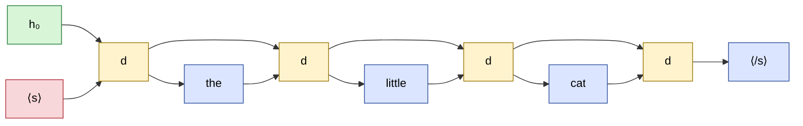

#ml-1 #ml-3

# Définition

La génération d'une séquence consiste à produire, un élément à la fois, une séquence de longueur inconnue, chaque sortie étant réinjectée comme entrée du pas suivant.

Un tel modèle est **autorégressif** : chaque sortie dépend des sorties précédentes.

À l'inférence, la réponse n'est pas connue : le modèle ne dispose que de l'entrée et construit la sortie token par token. Le token retenu à un pas est réinjecté en entrée du pas suivant, décalé d'une position (*shifted right*), et la boucle s'arrête au token de fin de séquence.

# Algorithme

Le décodeur $d$ reçoit à chaque pas l'élément qu'il vient de produire et l'état qu'il vient de calculer :

$$
(\hat{y}_t, h_t) = d(\hat{y}_{t-1}, h_{t-1})
$$

1. Initialiser avec un symbole factice de début : $\hat{y}_0 = \langle s \rangle$.
2. À chaque pas $t$, appliquer la récurrence pour obtenir $\hat{y}_t$ et $h_t$.
3. Réinjecter $\hat{y}_t$ comme entrée du pas $t+1$.
4. S'arrêter sur le symbole de fin $\langle /s \rangle$, ou à une longueur maximale fixée.

## Boucle d'inférence d'un Transformer

1. Faire passer l'entrée dans l'encodeur **une seule passe** et conserver l'état de **chaque position**, soit un vecteur par token ; les couches sont décrites dans [[Encodeur-décodeur pour les séquences]] et [[Architecture du Transformer]].
2. Initialiser la sortie avec le seul symbole de début, puis, à chaque pas, traiter les sorties décalées à droite : attention masquée, attention croisée vers les états de l'encodeur, projection sur le vocabulaire, choix d'un token.
3. Ajouter le token à la sortie et recommencer jusqu'au token de fin ; seules les clés et valeurs du nouveau token sont calculées, les précédentes étant relues au [[Cache de clés et de valeurs|cache]].

La sélection du token est l'argmax du softmax :

$$
\hat{y}_t = \arg\max_{w} \; \mathbb{P}(w \mid y_{<t}, x)
$$

où $y_{<t}$ désigne les tokens déjà générés et $x$ l'entrée fournie à l'encodeur.

# Exemple

Génération de la suite de mots « the little cat » : le décodeur part de $\langle s \rangle$, produit « the », qui devient son entrée au pas suivant, et ainsi de suite jusqu'au symbole de fin. Sur le schéma, le symbole de début est en rouge, l'état en vert, les cellules du décodeur en ambre et les tokens produits en bleu.

Réponse à la question « What is the height of the Eiffel Tower? » par un Transformer. L'encodeur traite la question, puis le décodeur part du seul symbole de début.

Au premier pas, la distribution de sortie est la suivante.

| Token | Probabilité |
|---|---|
| « It » | 0,12 |
| « The » | 0,81 |
| « car » | 0,01 |

Le token retenu est « The », réinjecté en entrée du décodeur décalée à droite. Au pas suivant, l'entrée du décodeur vaut « ⟨s⟩ The » et la distribution devient la suivante.

| Token | Probabilité |
|---|---|
| « tower » | 0,06 |
| « Eiffel » | 0,88 |
| « tree » | 0,02 |

Le token retenu est « Eiffel », réinjecté en entrée du décodeur décalée à droite. Au pas suivant, l'entrée du décodeur vaut « ⟨s⟩ The Eiffel » et la distribution devient la suivante.

| Token | Probabilité |
|---|---|
| « is » | 0,02 |
| « Tower » | 0,95 |
| « dog » | 0,01 |

Le token retenu est « Tower ». La boucle se poursuit de la même façon, chaque token produit allongeant l'entrée du décodeur, jusqu'au token de fin de séquence : la sortie complète est « The Eiffel Tower is 330 m. ».

# Remarque

Quand les éléments sont des classes (lettres, mots), $\hat{y}_t$ se choisit dans la distribution du softmax : soit la classe la plus probable, soit un tirage aléatoire, dont le degré d'aléa se règle par la [[Température d'un softmax|température]] du softmax. Retenir la classe la plus probable rend la génération déterministe.

Les sorties du décodeur étant décalées à droite, chaque position y prédit le token qui suit celui qu'elle porte.

- Le [[Mécanisme de copie]] s'applique à la génération : la décision de copier un token de l'entrée est recalculée à chaque pas.
