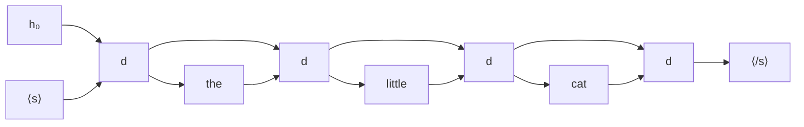

#ml-1

# Définition

La génération d'une séquence consiste à produire, un élément à la fois, une séquence de longueur inconnue, chaque sortie étant réinjectée comme entrée du pas suivant.

Un tel modèle est **autorégressif** : chaque sortie dépend des sorties précédentes.

# Algorithme

Le décodeur $d$ reçoit à chaque pas l'élément qu'il vient de produire et l'état qu'il vient de calculer :

$$
(\hat{y}_t, h_t) = d(\hat{y}_{t-1}, h_{t-1})
$$

1. Initialiser avec un symbole factice de début : $\hat{y}_0 = \langle s \rangle$.
2. À chaque pas $t$, appliquer la récurrence pour obtenir $\hat{y}_t$ et $h_t$.
3. Réinjecter $\hat{y}_t$ comme entrée du pas $t+1$.
4. S'arrêter sur le symbole de fin $\langle /s \rangle$, ou à une longueur maximale fixée.

# Exemple

Génération de la suite de mots « the little cat » : le décodeur part de $\langle s \rangle$, produit « the », qui devient son entrée au pas suivant, et ainsi de suite jusqu'au symbole de fin.

# Remarque

Quand les éléments sont des classes (lettres, mots), $\hat{y}_t$ se choisit dans la distribution du softmax : soit la classe la plus probable, soit un tirage aléatoire, dont le degré d'aléa se règle par la [[Température d'un softmax|température]] du softmax.

Le décodeur qui produit la séquence s'entraîne par [[Teacher forcing]].

La génération est l'étape de sortie d'un [[Encodeur-décodeur pour les séquences]].
