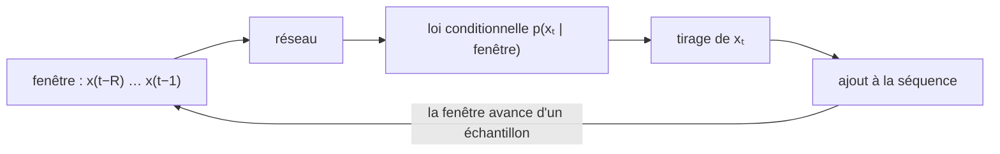

#ml-2

# Définition

L'**inférence autorégressive** est la génération d'une séquence par un modèle autorégressif, un échantillon à la fois : chaque nouvelle valeur est tirée de la distribution conditionnelle des $R$ échantillons précédents, puis ajoutée à la séquence d'entrée, qui sert de contexte au tirage suivant.

Le contexte de départ est un bruit initial : les premiers échantillons ne sont pas produits par le réseau mais tirés au hasard. $R$ est le [[Champ récepteur d'une pile de convolutions|champ récepteur]] du modèle, c'est-à-dire le nombre d'échantillons passés dont dépend chaque prédiction.

La séquence obtenue est une réalisation de la densité jointe factorisée par la [[Décomposition autorégressive d'une densité]] : un tirage par facteur conditionnel, dans l'ordre de la séquence.

# Algorithme

Échantillonnage d'une séquence de longueur $T$ :

1. Initialiser la séquence avec un bruit de $R$ échantillons $x_1, \dots, x_R$.
2. Pour $t = R+1, \dots, T$, tirer $x_t$ selon $p(x_t \mid x_{t-R}, \dots, x_{t-1})$.
3. Ajouter $x_t$ à la séquence et recommencer au pas suivant.

```
pour t = R+1, …, T :
    x_t ← tirage selon p(x_t | x_{t-R}, …, x_{t-1})
    ajouter x_t à la séquence
```

Chaque pas coûte une passe complète du réseau, relancé sur la nouvelle fenêtre d'entrée. Ce mode de génération est appelé **inférence naïve**.

# Propriétés

Un nouvel échantillon coûte une passe complète du réseau.

Le coût est linéaire en la longueur de la séquence générée : $T$ échantillons demandent $T$ passes, à champ récepteur fixé.

La génération est séquentielle : chaque tirage dépend du précédent, si bien qu'aucun parallélisme n'est possible sur l'axe temporel.

À une fréquence d'échantillonnage de $16$ kHz, une seconde d'audio compte $16\,000$ échantillons, donc $16\,000$ passes du réseau pour une seconde générée.

La fenêtre glissante est bornée par $R$ : seuls les $R$ derniers échantillons sont lus à chaque pas, et chaque nouvel échantillon en fait sortir un autre du contexte.

# Exemple

Schéma de génération pour $R = 4$ :

| Position | 1 | 2 | 3 | 4 | 5 | 6 | 7 | 8 | 9 | 10 | 11 | 12 |
| --- | --- | --- | --- | --- | --- | --- | --- | --- | --- | --- | --- | --- |
| Contenu | bruit | bruit | bruit | bruit | généré | généré | généré | généré | généré | généré | à prédire | à prédire |

Les cases grises, positions $1$ à $4$, forment le bruit initial. Les cases orangées, positions $5$ à $10$, sont les échantillons déjà produits. Les cases pointillées, positions $11$ et $12$, sont les positions restant à prédire, une par une. Les images successives du schéma avancent la fenêtre d'un seul échantillon.



Pour tirer $x_{11}$, le réseau lit les quatre échantillons précédents :

$$
x_{11} \sim p(x_{11} \mid x_7, \dots, x_{10}), \text{ puis on l'ajoute à la séquence}
$$

La fenêtre avance alors d'un cran, et $x_{12}$ est tiré à son tour :

$$
x_{12} \sim p(x_{12} \mid x_8, \dots, x_{11})
$$

Les trois premiers tirages se lisent de la même façon :

| Tirage | Contexte lu | Loi |
| --- | --- | --- |
| $x_6$ | $x_2, \dots, x_5$ | $p(x_6 \mid x_2, \dots, x_5)$ |
| $x_7$ | $x_3, \dots, x_6$ | $p(x_7 \mid x_3, \dots, x_6)$ |
| $x_8$ | $x_4, \dots, x_7$ | $p(x_8 \mid x_4, \dots, x_7)$ |

Une seconde d'audio à $16$ kHz exige ainsi $16\,000$ passes, chaque passe ne produisant qu'un seul nouvel échantillon.

# Interprétation

Le qualificatif naïf signale l'absence de réutilisation : le réseau ne conserve aucun état d'un pas à l'autre, tout le contexte est relu à chaque tirage. La génération reste exacte, au sens où chaque échantillon est bien tiré dans la loi conditionnelle apprise, mais elle paie le prix fort.

Ce coût contraste avec l'entraînement, où le [[Teacher forcing]] fournit à chaque position le vrai échantillon précédent et où une seule passe calcule toutes les positions en parallèle. À l'inférence, cette parallélisation disparaît : le temps de génération croît avec la durée du signal produit, comme dans toute [[Génération d'une séquence]].

Le schéma d'une [[Architecture WaveNet]] rend le mécanisme visible : le réseau ne produit qu'un échantillon à la fois, conditionné par les $R$ valeurs précédentes, puis il est réexécuté pour la position suivante.

# Remarque

Le nombre de passes ne dépend ni du champ récepteur ni de la profondeur du réseau : il vaut exactement le nombre d'échantillons à produire. Augmenter $R$ élargit le contexte lu à chaque passe, donc le coût d'une passe, mais ne change pas leur nombre.

Une minute d'audio à $16$ kHz demande près d'un million de passes, ce qui rend la génération naïve coûteuse en pratique.

Le modèle lit ses propres sorties : une erreur commise sur un échantillon entre dans le contexte des suivants et s'y propage, phénomène de biais d'exposition décrit avec le [[Teacher forcing]].

La [[Génération d'une séquence]] décrit le même principe pour des symboles discrets ; ici les échantillons sont des valeurs audio quantifiées, décrites dans [[Audio numérique]], et le tirage se fait dans une distribution sur ces valeurs.

- Le [[Cache de clés et de valeurs]] supprime le recalcul du préfixe à chaque pas, ce qui allège le coût de cette inférence naïve sans changer le résultat.
