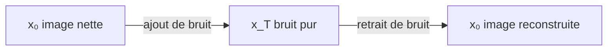

#ml-2

# Définition

Un **modèle de diffusion** est un [[Panorama des modèles génératifs|modèle génératif]] qui fabrique une image à partir de bruit par un processus en deux temps, indexé de $t=0$ à $t=T$ :

- le **processus direct** (*forward*) ajoute progressivement du bruit à une image ;
- le **processus inverse** (*reverse*) retire progressivement ce bruit pour reconstruire l'image.

La notation $\mathbf{x}_{0:T}$ désigne la suite des états de l'image de $t=0$ à $t=T$ : à $t=0$ l'image est nette, à $t=T$ elle n'est plus que du bruit.

En pratique, le processus compte des centaines ou des milliers d'étapes, et non un seul passage du réseau.

# Propriétés

**Trajectoire directe.** La trajectoire directe $q(\mathbf{x}_{0:T})$ décrit l'ajout de bruit : partant de l'image à $t=0$, chaque étape la dégrade un peu plus jusqu'au bruit pur en $t=T$.

**Trajectoire inverse.** La trajectoire inverse $p_\theta(\mathbf{x}_{0:T})$, paramétrée par $\theta$, décrit le débruitage : elle part du bruit pur et reconstruit une image en $T$ étapes.

**Terme de dérive.** Le terme de dérive $\mu_\theta(\mathbf{x}_t, t) - \mathbf{x}_t$ est le déplacement que le modèle applique à l'état $\mathbf{x}_t$ à l'instant $t$ : $\mu_\theta(\mathbf{x}_t, t)$ est l'état visé par le débruitage, et la différence avec $\mathbf{x}_t$ donne la direction et l'amplitude du pas. Ce terme se lit comme un champ de vecteurs sur l'espace des états.



# Algorithme

La génération est une inversion pas à pas du processus direct : à chaque étape, le terme de dérive fournit le déplacement moyen à appliquer à l'état courant.

```
entrée : un état initial x_T tiré comme du bruit pur
pour t = T, T-1, ..., 1 :
    calculer le déplacement moyen mu_theta(x_t, t) - x_t
    déplacer l'état x_t de ce déplacement moyen pour obtenir x_(t-1)
sortie : x_0, l'état reconstruit
```

# Exemple

Sur un nuage de points 2D en spirale, les trois trajectoires se lisent aux temps $t=0$, $t=T/2$ et $t=T$ :

| Grandeur | $t=0$ | $t=T/2$ | $t=T$ |
|---|---|---|---|
| Trajectoire directe $q(\mathbf{x}_{0:T})$ | spirale nette | anneau bruité | bruit pur |
| Trajectoire inverse $p_\theta(\mathbf{x}_{0:T})$ | spirale reconstruite | anneau encore bruité | bruit pur |
| Terme de dérive $\mu_\theta(\mathbf{x}_t, t) - \mathbf{x}_t$ | champ de vecteurs structuré par la distribution des données | champ de vecteurs plus diffus | champ de vecteurs de faible amplitude, sans structure nette |

La trajectoire directe déforme la spirale jusqu'à la confondre avec le bruit ; la trajectoire inverse suit le même chemin à l'envers, du bruit vers la spirale ; le terme de dérive visualise, à chaque instant, le déplacement que le modèle applique pour ce retour. L'illustration emploie un nuage de points 2D plutôt qu'une image, pour rendre les états et le champ de dérive directement visibles.

# Remarque

Le modèle de diffusion est une alternative non adversariale au [[Réseau antagoniste génératif]] : la génération ne repose pas sur un jeu entre deux réseaux, mais sur une longue suite d'étapes de débruitage. Le coût de cette régularité est le nombre d'étapes : des centaines ou des milliers de passages, là où un modèle à variable latente produit un échantillon en un seul passage.

Le processus inverse s'apparente à un [[Décodeur génératif]] appliqué de façon répétée : il transforme un état bruité en un état un peu moins bruité, jusqu'à l'image. La [[Diffusion latente]] transpose ce même schéma dans l'espace latent d'un auto-encodeur, ce qui réduit le coût de chaque étape.
