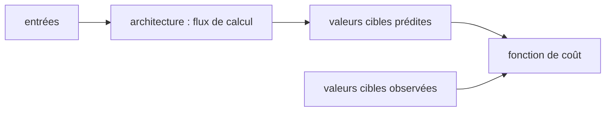

#ml-2

# Définition

Un modèle neuronal est un flux de calcul qui transforme des entrées en une ou plusieurs valeurs cibles.

# Modèle

Définir un modèle revient à trancher trois questions :

- la logique du modèle : le raisonnement que les calculs doivent suivre ;
- l'architecture : l'organisation des calculs, qui fixe la classe de fonctions représentables ;
- la ou les fonctions de coût : la quantité qui mesure l'écart aux valeurs cibles, donc ce que l'optimisation cherche à réduire.

Le choix d'architecture peut reprendre une forme déjà éprouvée, par exemple le [[Perceptron multicouche]] ; le choix de la fonction de coût se lit avec les notions de [[Métrique et fonction de perte]].

# Interprétation

On donne au modèle les outils pour résoudre la tâche, en espérant que l'optimisation trouve un chemin : rien ne garantit qu'il apprenne ce qui était visé. Un [[Réseau de neurones|réseau de neurones]] doté d'une architecture et d'un objectif se comporte donc selon ce que l'optimisation découvre, et pas seulement selon l'intention du concepteur.

# Remarque

La fonction de coût n'est qu'un objectif intermédiaire : le modèle peut maximiser son objectif d'une manière non voulue, ce que l'on appelle le *reward hacking*. En apprentissage par renforcement à partir de retours humains (RLHF), ce détournement de l'objectif s'observe également. Cet écart entre l'objectif optimisé et le comportement souhaité s'ajoute au risque de ne pas généraliser, traité dans [[Surapprentissage et sous-apprentissage]].
