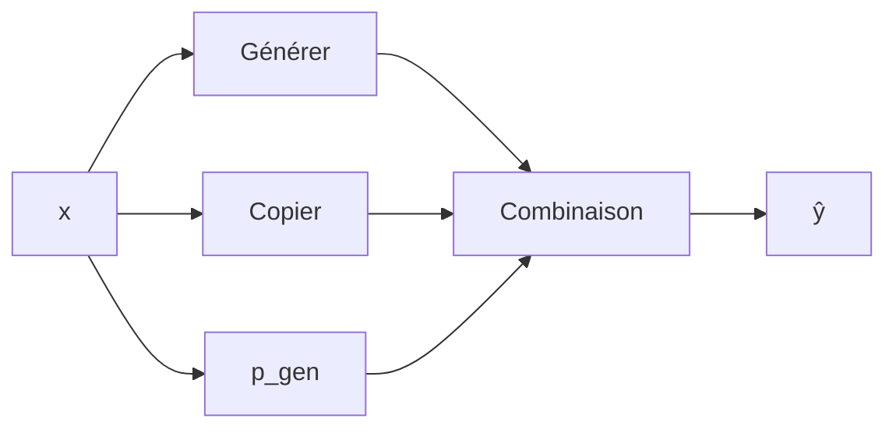

#ml-3

# Définition

Le mécanisme de copie, ou pointer-generator, remplace la prédiction d'un unique modèle par la coopération de deux modèles pour produire le mot suivant d'une séquence.

Il répond à une difficulté de la génération de texte : les mots rares, en particulier les entités nommées, sont mal prédits, ou même absents du vocabulaire.

Les deux modèles sont les suivants :

- le modèle 1, generate, est le décodeur récurrent qui prédit un mot du vocabulaire, avec la même notation que dans un décodeur classique ;
- le modèle 2, copy, recopie un mot de l'entrée : les poids d'attention deviennent une distribution sur les mots d'entrée.

Une décision $p_{\text{gen}} = \Pr(\text{générer})$ indique lequel des deux modèles privilégier, puis une moyenne pondérée combine leurs distributions. Le schéma est celui d'une [[Combinaison de modèles]], avec une distribution de copie à la place du second modèle.

# Modèle

## Génération sur le vocabulaire

Le modèle de génération est un décodeur récurrent : à chaque pas de temps $t$, il dispose de l'état $d_t$ et du contexte d'attention $c_t$ produits par [[Attention dans un encodeur-décodeur]].

La probabilité attribuée au mot $w$ par ce modèle est

$$\mathbb{P}_{\text{vocab}}(w) = \operatorname{softmax}\left(V[d_t;c_t] + b\right)_w$$

où $V$ est la matrice de sortie et $b$ le biais, l'indice $w$ sélectionnant la composante associée au mot $w$.

## Copie depuis l'entrée

Le modèle de copie réutilise les poids d'attention $a_i$ portés sur les mots d'entrée $x_i$. Pour un mot $w$ présent plusieurs fois dans l'entrée, les poids des positions correspondantes s'additionnent :

$$\mathbb{P}_{\text{copy}}(w) = \sum_{i\,:\,x_i=w} a_i$$

Tout mot absent de l'entrée reçoit ainsi une probabilité de copie nulle.

## Décision

La décision de générer plutôt que de copier est une fonction logistique des états disponibles au pas de temps $t$ :

$$p_{\text{gen}} = \sigma\left(\mathbf{w}_c \cdot c_t + \mathbf{w}_d \cdot d_t + \mathbf{w}_y \cdot \hat{y}_t + b\right)$$

où $\hat{y}_t$ est la sortie du décodeur au pas précédent, et où les vecteurs $\mathbf{w}_c$, $\mathbf{w}_d$, $\mathbf{w}_y$ et le biais $b$ sont appris.

## Combinaison

Les deux distributions sont moyennées avec le poids donné par la décision, comme pour une [[Combinaison de modèles]] à deux modèles :

$$\mathbb{P}(w) = p_{\text{gen}}\,\mathbb{P}_{\text{vocab}}(w) + (1 - p_{\text{gen}})\sum_{i\,:\,x_i=w} a_i$$

# Interprétation

Lorsque $p_{\text{gen}}$ est faible, le modèle privilégie la copie et reproduit fidèlement un mot de l'entrée.

Un nom rare de l'entrée peut donc être copié même si $\mathbb{P}_{\text{vocab}}(w) = 0$, c'est-à-dire même si le mot est absent du vocabulaire de génération : la copie contourne la limitation du vocabulaire.

La décision $p_{\text{gen}}$ est recalculée à chaque pas de temps, ce qui permet d'alterner génération et copie au fil de la séquence produite par [[Génération d'une séquence]].

# Remarque

Les deux modèles partagent la même notation : l'état $d_t$ et le contexte $c_t$ servent à la fois au calcul de $\mathbb{P}_{\text{vocab}}$ et à la décision $p_{\text{gen}}$, et les poids d'attention $a_i$ servent à la fois de contexte et de distribution de copie.
